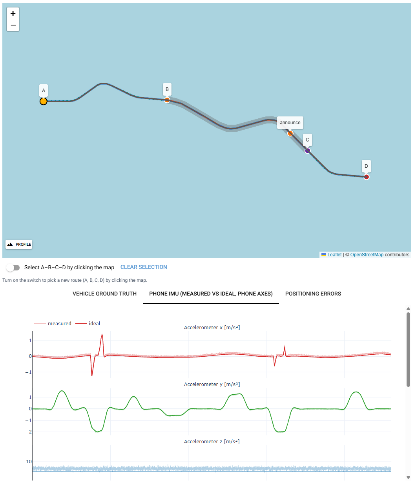

# ThroughTunnel

Case study: keeping a phone's position through a GPS outage in a road tunnel. A car drives a real road
(OpenStreetMap) or a synthetic one; the simulator produces physically consistent ground truth and what
a phone mounted in the car records (accelerometer, gyroscope, GPS fixes). Position estimators receive
only those phone observations and the route map, and are evaluated against the hidden truth, including
the timing of the exit announcement.

**Status: complete.** The write-up is **[docs/report.md](docs/report.md)**: the problem and its
interpretation, the simulator, the approach, the evaluation, results, limitations and future work.

Documentation:
* [docs/report.md](docs/report.md): the write-up (start here).
* [docs/benchmark/README.md](docs/benchmark/README.md): the benchmarks, their configurations and the milestone results.
* [docs/limitations.md](docs/limitations.md): what is and is not simulated, with the expected effect of each.
* [docs/decisions.md](docs/decisions.md): decision log.
* [docs/design.md](docs/design.md): simulator design as implemented.
* [docs/positioning_design.md](docs/positioning_design.md): positioning architecture and estimators.
* [docs/estimator_plan.md](docs/estimator_plan.md): the estimator work step by step; each step links its study.
* [docs/results.md](docs/results.md): the first positioning results (2026-10-12, historical).


**Demo video:** [docs/img/demo.mp4](docs/img/demo.mp4) (55 s, played back at 10×). The Eisenhower tunnel
with an underwater grade profile, stop-and-go traffic and the Realistic sensor errors: the true car and
four estimators (Route + IMU, Kalman filter, Kalman filter + map curves, car-speed reference) on the map.
It shows one typical run; how often the estimators fail in this setting is in section 5 of the
[report](docs/report.md).

## Quick start

Requires [uv](https://docs.astral.sh/uv/) (Python 3.14 is pinned by the project).

```bash
uv sync                      # create the environment
uv run throughtunnel         # start the UI at http://127.0.0.1:8080 (opens a browser)
uv run pytest                # validation test suite (348 tests, about 6 min, no network needed)
```

Options: `uv run throughtunnel --port 8090 --host 0.0.0.0 --no-browser`.

## Using the simulator

1. **Pick a scenario.** Either choose a preset (*Seattle SR 99 Tunnel*, *Eisenhower Tunnel*, *Synthetic demo
   route*, *Synthetic 5 km tunnel* = the benchmark's 5 km geometry, *Synthetic 10 km tunnel, nearly straight*:
   beyond the case-study range and not benchmarked, it shows the cumulative drift without curves), or turn on *Select A–B–C–D by clicking the map* (off by default, so panning the map
   never moves points) and click four points on the map:
   * **A** start;
   * **B** tunnel entrance;
   * **C** tunnel exit;
   * **D** end.

   The route A→B→C→D is computed with OSRM on OpenStreetMap data; B–C becomes a *simulated* tunnel
   (ideally 0.5–5 km). Place the points along one driving direction: routes that turn back are
   rejected. The map shows:
   * the raw OSM polyline (grey dashed) and the smoothed driven path (blue);
   * the tunnel as a wide grey band;
   * A–D and the navigation-exit markers;
   * the GPS fixes as a dotted line with a gap in the tunnel.

   The panel shows the lengths, the GPS outage, the smoothing deviation and any warnings.
2. **Play it back.** Use play/pause, restart, playback speed (0.5×–20×), and seek with the slider or by
   clicking a plot. The vehicle (yellow) moves along the road with a heading tick, the travelled trail
   is drawn in orange, and the readouts and plot cursor follow the simulation time. The *Road profile* panel at
   the bottom of the map (hidden by default: open it with *Profile*, hide it with ×) shows the road height along the
   route, the tunnel B–C and the announcement point, with the vehicle and every visible estimator moving
   on it, and the grade at the vehicle.
3. **Change the scenario.** Under *Drive and simulation* (the last settings group) you can set the driver style (calm / normal /
   sporty), cruise speed, speed variability, the lateral/longitudinal acceleration and jerk limits, the
   road smoothing settings, the random seed and the sample rate, and the *vehicle speed scale error*:
   the car's own speed reading (OBD / speedometer), reference information that only a dedicated
   reference estimator receives (D41). Then press **Generate**.
4. **Mount the phone.** Under *Phone IMU: mounting, errors, calibration* → *Mounting* pick a mounting
   preset (aligned with the vehicle, flat in portrait, dashboard holder in portrait / tilted /
   landscape) or set yaw, pitch and roll yourself. The lever arm (where the phone sits relative to the
   rear axle) and optional Earth rotation are under *More* at the end of the group. The panel says where each phone axis points in the car. Only the sensor model is
   re-run; the vehicle motion stays identical.
5. **Make the sensors imperfect.** The quickest way is the *Sensor errors* row above the settings
   groups: one click sets all IMU errors, GPS errors and the calibration error together (D56).
   * **Error-free**: no IMU, GPS or calibration error (the algorithm floor).
   * **Good**: smartphone IMU noise and bias, no bias drift, clean GPS up to the portal, no calibration
     error (what the bundled scenario files contain).
   * **Realistic** (default): the benchmark setting, Good + IMU bias drift + GPS degradation before the
     portal.
   * **Hard**: Realistic + a calibration error (yaw 2°, pitch 0.5°, roll 0.5°).

   The mount, the outage geometry, rates and seeds stay as they are, so switching levels compares on
   the same drive. Bundled scenarios load with the selected level; uploaded files keep their own
   settings. Any other setting shows *custom*. For finer control, in the IMU group *Sensor errors* has
   one master switch for all IMU errors (off = error-free IMU; the individual settings are kept). Below it, switch accelerometer
   and gyroscope white noise, constant bias and bias drift on or off. Magnitudes are in datasheet units
   (µg/√Hz, mg, mdps/√Hz, °/s). The IMU rate (default 200 Hz) and a *sensor seed* (a new noise and bias
   realisation on the same drive) are under *More*. The panel shows the resulting per-sample σ and the bias actually
   applied. The *Phone IMU* tab plots measured (light) against ideal (dark) readings for each phone
   axis, and the readouts show both.
6. **Compare position estimators.** After every generation, all estimators run on the same phone
   observations:
   * **Map:** each has a coloured track and a moving marker (toggle them in the *Positioning* card).
     Solid lines are the four main phone-only estimators, dashed or dotted lines the baselines, greys the
     † reference and ‡ oracles (D58).
     Hover over an estimator's name there for a short note: whether it is phone-only, † reference or
     ‡ oracle, what it does, and its pipeline, e.g. *GPS fixes + IMU → calibration → Kalman filter → position
     on the route ± σ*.
   * **Summary table:** error at the tunnel exit, max/RMS in the tunnel, recovery time after C, and
     exit-announcement timing.
   * **Positioning errors tab:** total, along-track and cross-track error over time.
   * **Live readout:** each estimator's current error.

   Settings groups below the cards, most used first. *Tunnel: exit announcement and traffic* sets
   how far before the tunnel exit C the app announces the exit (one announcement per estimator,
   triggered from its own estimate; default 300 m) and the traffic, which adds a portal slowdown, a tunnel speed limit,
   stop-and-go, an exit queue or congested flow, with real stops (anchored to B/C, seeded).
   *Road profile (elevation)* sets the road's height: drag the points
   up or down, or start from a template (steady climb, climb inside the tunnel, underwater tunnel).
   The grade never exceeds the limit (default 6%), and the drive re-simulates.
   *Phone GPS* holds the GPS error model, loss and reacquisition. Two optional realism effects (on in the
   Realistic and Hard presets): *Bias drift (in-run)* per IMU sensor, and *Degradation before the tunnel* for GPS
   (multipath, jumps). Switched-off options hide their sliders. *Calibration error* (in the IMU group)
   rotates the phone-to-vehicle
   orientation of the alignment step that feeds the estimators (yaw, pitch, roll) without changing the
   actual mount or any sensor data. Only positioning re-runs, so with/without comparisons are exactly paired
   ([docs/calibration_error.md](docs/calibration_error.md)). In *Road profile*, *Estimators use the
   road grade from the map* gives the estimators the road grade along the route (assumed exact); the IMU estimators
   then remove the gravity it adds to the forward accelerometer axis. Again only positioning re-runs
   ([docs/map_grade_study.md](docs/map_grade_study.md)).
7. **Reproduce it.** *Save scenario* downloads a JSON file with the route geometry *as fetched*, every
   parameter (phone mounting, IMU rate and errors included) and the seeds. *Load scenario* replays it
   bit-for-bit, offline.



### Programmatic use

The simulation core has no UI dependency:

```python
from throughtunnel.scenario import load_preset, run_scenario

result = run_scenario(load_preset("seattle_sr99_tunnel"))
truth = result.truth                 # GroundTruth: hidden simulation state, columnar arrays at 100 Hz
truth.t, truth.speed, truth.yaw_rate, truth.acc_body, truth.omega_body
imu = result.imu                     # ImuStream: the observation (measured; 200 Hz, Android axes)
result.imu_ideal, result.imu_errors  # error-free readings and the applied bias/sigma (hidden, for analysis)
result.path.diagnostics              # road-geometry processing report

from throughtunnel.scenario import with_imu_config
from throughtunnel.sensors import MOUNT_PRESETS, ImuConfig
dash = with_imu_config(result, ImuConfig(mount=MOUNT_PRESETS["dash_portrait"]))  # same drive, new mount

# Positioning: estimators see only result.observations() (measured IMU, GPS fixes, route map).
from throughtunnel.evaluation.experiment import compare_estimators
for ev in compare_estimators(result).evaluations:
    print(ev.label, ev.summary["exit_total_m"], ev.announcement_time_error_s)  # + = late, NaN = missed
```

The benchmarks behind the report write tables, raw per-run results and the configuration to `--out`
(the full runs take about 30–40 minutes each):

```bash
uv run python -m throughtunnel.evaluation.benchmark --seeds 20 --out out/benchmark --compare docs/benchmark/milestone_step5/benchmark
uv run python -m throughtunnel.evaluation.error_sources --seeds 20 --out out/error_sources --compare docs/benchmark/milestone_step5/error_sources
uv run python -m throughtunnel.evaluation.benchmark --dev --out out/dev --compare docs/benchmark/milestone_step5/benchmark   # development subset, ~6 min
uv run python -m throughtunnel.evaluation.report_figures --out docs/img     # report figure, from the saved runs
```

The earlier studies, each reproducing the tables of its document:

```bash
uv run python -m throughtunnel.evaluation.report --seeds 20 --vary-drive    # docs/results.md
uv run python -m throughtunnel.evaluation.calibration_study --seeds 10     # docs/calibration_error.md
uv run python -m throughtunnel.evaluation.factor_study --seeds 20          # docs/factor_study.md (+ figures)
uv run python -m throughtunnel.evaluation.slope_study --seeds 20           # docs/slope_study.md (+ figures)
uv run python -m throughtunnel.evaluation.traffic_study --seeds 20         # docs/traffic_study.md (+ figures)
uv run python -m throughtunnel.evaluation.realism_check --seeds 10         # docs/realism_check/tables.md
uv run python -m throughtunnel.evaluation.map_grade_study --seeds 20       # docs/map_grade_study.md (+ figures)
```

The figures need matplotlib, a dev dependency (installed by `uv sync`). The simulator does not need it.

To simulate your own road, build a `ScenarioConfig(route=RawRoute(...))` or use
`OsrmRouteProvider().route(start, end)`.

## Project layout

```
src/throughtunnel/
  geodesy.py            WGS84 geodetic <-> ECEF <-> local ENU
  routing/              RawRoute model, OSRM provider, synthetic test roads
  road.py               map polyline -> smooth arc-length path (+ diagnostics)
  vehicle/              driver config, speed planning, longitudinal dynamics, ground truth
  sensors/              phone mounting, IMU and GPS measurement models
  observations.py       what a phone app may see: ImuStream, GnssStream, RouteMap (truth boundary)
  positioning/          estimator contract, causal runner, alignment, estimators
  evaluation/           errors vs. truth, Monte Carlo, report
  scenario.py           ScenarioConfig, run_scenario, seeds, JSON persistence, presets
  presets/              bundled scenarios (route geometry cached -> work offline)
  app/                  NiceGUI front-end (depends on the core, never the reverse)
tests/                  physics and reproducibility validation
docs/design.md          design decisions, frames, models, assumptions, limitations
```

## Ground truth (per sample, default 100 Hz)

`t, s, x, y, z, lat, lon, alt, speed, accel_long, accel_lat, jerk, yaw, bearing_deg, yaw_rate, yaw_accel,
curvature, roll, pitch`, plus the vectors `acc_enu`, `acc_body` and `omega_body` (N×3). The navigation
frame is local ENU and the body frame is ISO 8855 (x forward, y left, z up). Positive yaw rate and
positive lateral acceleration mean a left turn. See [docs/design.md](docs/design.md#3-coordinate-frames-and-conventions).

The ground truth is the simulator's hidden reality. Positioning algorithms only
receive sensor observations and explicitly allowed side information.

## Phone IMU (`ImuStream`)

* **Axes:** Android `SensorEvent` convention. With the phone in portrait: x = right edge, y = top edge,
  z = out of the screen. Units are m/s² and rad/s.
* **Accelerometer = specific force** at the phone, f = a − g. A phone lying still, screen up, reads
  +g on z. Gravity is WGS84 normal gravity at the vehicle's latitude. When the phone is not at the
  vehicle reference point, the lever-arm terms α×r + ω×(ω×r) are included.
* **Gyroscope** = angular rate of the phone. Optional Earth rotation adds the Earth rate to the gyro
  and the Coriolis term to the accelerometer.
* **Mounting:** the rotation from the phone frame to the vehicle frame, given as Z-Y-X Euler angles
  (all zeros = phone axes aligned with the vehicle's x forward, y left, z up).
* `ImuStream` deliberately carries no ground truth, not even the true mounting: a real app does not
  know how the phone sits in the car. A recorded-phone loader will produce the same type.

* **Sample rate:** a separate, constant phone-sensor clock (default 200 Hz, 10–2000 Hz). The vehicle state
  is evaluated *exactly* at each IMU timestamp. The motion has constant jerk between simulation steps,
  so even a 400 Hz IMU on a 100 Hz simulation gets genuinely new samples, not repeated or
  interpolated ones.
* **Errors:** measured = ideal + b + n. Here n is Gaussian white noise given as a noise density N
  (per-sample σ = N·√rate), and b is a constant bias (given magnitude, direction drawn from the seed,
  or an explicit vector). Accelerometer and gyroscope noise and bias can each be enabled separately.
  The defaults are smartphone-class: 180 µg/√Hz, 10 mg, 7 mdps/√Hz, 0.1 °/s.
* **Randomness:** each error source has its own seeded stream. Toggling or rescaling one source
  never changes another, and the same seed reproduces the same run. The sensor seed defaults to the
  scenario seed.

## Assumptions and limitations

The assumptions (route and tunnel known from the map, phone fixed in a holder, the phone's location
fixes as GPS, single-lane tunnels) are set out in section 1 of the [report](docs/report.md). What is not
simulated, with the expected effect of each, is in [docs/limitations.md](docs/limitations.md). Road
grade, traffic, IMU bias drift and GPS degradation before the portal are optional and can be switched on
in the UI.

## Development history

- **Simulator** (2026-10-12 to 2026-10-13): vehicle on real or synthetic roads, phone IMU with mounting
  and errors, phone GPS, A–D scenarios, the causal estimator framework and the UI.
- **Realism** (2026-10-13 to 2026-10-15): road grade, traffic, IMU bias drift, GPS degradation before the
  portal and the car's speed reading as a reference; then the simulator was frozen.
- **Benchmarks** (2026-10-15): 48 scenarios and an error-source benchmark, with saved configurations and
  baselines ([docs/benchmark/README.md](docs/benchmark/README.md)).
- **Estimators** (2026-10-16 to 2026-10-17): portal freeze, calibration fixes, standstill oracle,
  route-constrained Kalman filters (offset, yaw, map curves) and the uncertainty-aware announcement, one
  step at a time against the benchmarks ([docs/estimator_plan.md](docs/estimator_plan.md)).
- **UI polish and write-up** (2026-10-18).

Every decision is recorded in [docs/decisions.md](docs/decisions.md).

## Data and services

Map tiles and road geometry © [OpenStreetMap](https://www.openstreetmap.org/copyright) contributors
(ODbL). Routing uses the public [OSRM](https://project-osrm.org/) demo server, which is meant for light
development use; set `OsrmRouteProvider(base_url=...)` to use a self-hosted instance.
