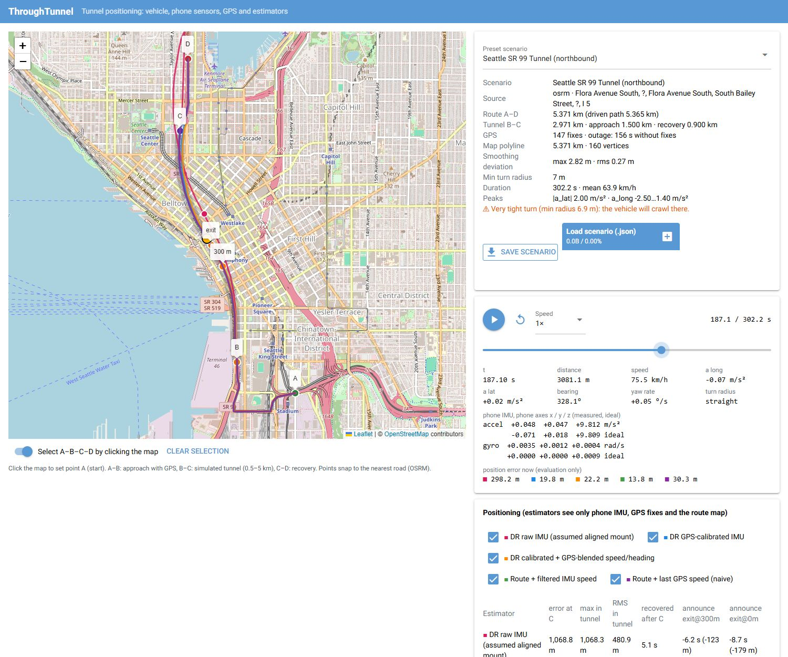
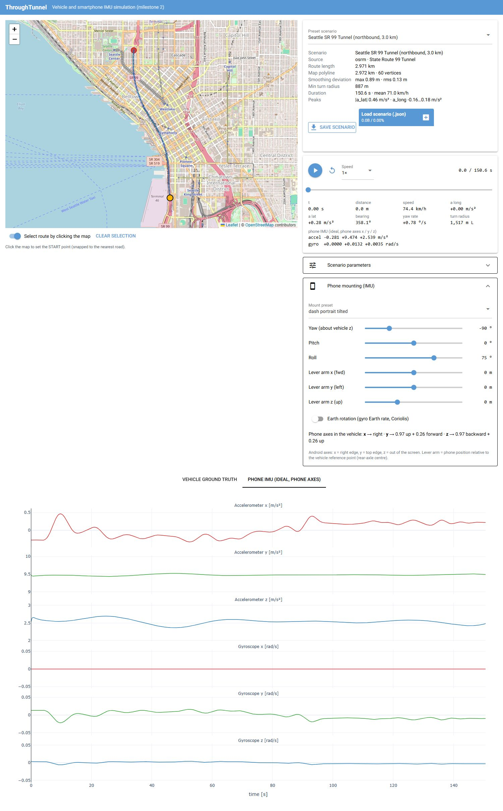

# ThroughTunnel

A vehicle and smartphone-sensor simulator for **GPS-denied positioning research**. A car drives a real
road (OpenStreetMap) treated as a tunnel; the simulator produces physically consistent ground truth and
what the accelerometer and gyroscope of a phone mounted in the car would measure.

**Status: vehicle simulation and smartphone IMU (accelerometer and gyroscope) complete.** The IMU has a
configurable sample rate, white noise and constant bias, and the ideal readings are kept for comparison.
GPS simulation, A–D scenarios (approach → simulated tunnel → recovery) and positioning are planned; see
[docs/roadmap.md](docs/roadmap.md).

Documentation:
* [docs/design.md](docs/design.md): simulator design as implemented.
* [docs/decisions.md](docs/decisions.md): decision log.
* [docs/roadmap.md](docs/roadmap.md): status, tasks, open decisions.
* [docs/positioning_design.md](docs/positioning_design.md): proposed positioning architecture and
  baseline.



## Quick start

Requires [uv](https://docs.astral.sh/uv/) (Python 3.14 is pinned by the project).

```bash
uv sync                      # create the environment
uv run throughtunnel         # start the UI at http://127.0.0.1:8080 (opens a browser)
uv run pytest                # validation test suite (~5 s, no network needed)
```

Options: `uv run throughtunnel --port 8090 --host 0.0.0.0 --no-browser`.

## Using the simulator

1. **Pick a scenario.** Either choose a preset (*Seattle SR 99 Tunnel*, *Eisenhower Tunnel*, *Synthetic demo
   track*), or click a start point and a destination on the map. The route is computed with OSRM on
   OpenStreetMap data and snapped to the road network, and the scenario is generated immediately.
   The map shows the raw OSM polyline (grey, dashed) and the smoothed drivable path (blue). The panel
   shows the route length (highlighted when outside the 0.5–5 km tunnel range), how far the path
   deviates from the map polyline, the minimum turn radius, and any warnings.
2. **Play it back.** Use play/pause, restart, playback speed (0.5×–20×), and seek with the slider or by
   clicking a plot. The vehicle (yellow) moves along the road with a heading tick, the travelled trail
   is drawn in orange, and the readouts and plot cursor follow the simulation time.
3. **Change the scenario.** Under *Scenario parameters* you can set the driver style (calm / normal /
   sporty), cruise speed, speed variability, the lateral/longitudinal acceleration and jerk limits, the
   road smoothing settings, the random seed and the sample rate. Then press **Generate**.
4. **Mount the phone.** Under *Phone mounting (IMU)* pick a mounting preset (aligned with the vehicle,
   flat in portrait, dashboard holder in portrait / tilted / landscape) or set yaw, pitch and roll
   yourself, plus a lever arm (where the phone sits relative to the rear axle) and optional Earth
   rotation. The panel says where each phone axis points in the car. Only the sensor model is
   re-run; the vehicle motion stays identical.
5. **Make the sensors imperfect.** Under *IMU sample rate & errors* set the phone sensor rate (default
   200 Hz) and switch accelerometer and gyroscope white noise and constant bias on or off. Magnitudes
   are in datasheet units (µg/√Hz, mg, mdps/√Hz, °/s). Set a *sensor seed* to draw a new noise and bias
   realisation on the same drive. The panel shows the resulting per-sample σ and the bias actually
   applied. The *Phone IMU* tab plots measured (light) against ideal (dark) readings for each phone
   axis, and the readouts show both.
6. **Reproduce it.** *Save scenario* downloads a JSON file with the route geometry *as fetched*, every
   parameter (phone mounting, IMU rate and errors included) and the seeds. *Load scenario* replays it
   bit-for-bit, offline.



### Programmatic use

The simulation core has no UI dependency:

```python
from throughtunnel.scenario import load_preset, run_scenario

result = run_scenario(load_preset("seattle_sr99_tunnel"))
truth = result.truth                 # GroundTruth: hidden simulation state, columnar arrays at 100 Hz
truth.t, truth.speed, truth.yaw_rate, truth.acc_body, truth.omega_body
imu = result.imu                     # ImuStream: the observation (measured; 200 Hz, Android axes)
result.imu_ideal, result.imu_errors  # error-free readings and the applied bias/sigma (hidden, for analysis)
result.path.diagnostics              # road-geometry processing report

from throughtunnel.scenario import with_imu_config
from throughtunnel.sensors import MOUNT_PRESETS, ImuConfig
dash = with_imu_config(result, ImuConfig(mount=MOUNT_PRESETS["dash_portrait"]))  # same drive, new mount
```

To simulate your own road, build a `ScenarioConfig(route=RawRoute(...))` or use
`OsrmRouteProvider().route(start, end)`.

## Project layout

```
src/throughtunnel/
  geodesy.py            WGS84 geodetic <-> ECEF <-> local ENU
  routing/              RawRoute model, OSRM provider, synthetic test roads
  road.py               map polyline -> smooth arc-length path (+ diagnostics)
  vehicle/              driver config, speed planning, longitudinal dynamics, ground truth
  sensors/              phone mounting, IMU measurement model, ImuStream observation type
  scenario.py           ScenarioConfig, run_scenario, seeds, JSON persistence, presets
  presets/              bundled scenarios (route geometry cached -> work offline)
  app/                  NiceGUI front-end (depends on the core, never the reverse)
tests/                  physics and reproducibility validation
docs/design.md          design decisions, frames, models, assumptions, limitations
```

## Ground truth (per sample, default 100 Hz)

`t, s, x, y, z, lat, lon, alt, speed, accel_long, accel_lat, jerk, yaw, bearing_deg, yaw_rate, yaw_accel,
curvature, roll, pitch`, plus the vectors `acc_enu`, `acc_body` and `omega_body` (N×3). The navigation
frame is local ENU and the body frame is ISO 8855 (x forward, y left, z up). Positive yaw rate and
positive lateral acceleration mean a left turn. See [docs/design.md](docs/design.md#3-coordinate-frames-and-conventions).

The ground truth is the simulator's hidden reality. Positioning algorithms (later milestones) will only
receive sensor observations and explicitly allowed side information.

## Phone IMU (`ImuStream`)

* **Axes:** Android `SensorEvent` convention. With the phone in portrait: x = right edge, y = top edge,
  z = out of the screen. Units are m/s² and rad/s.
* **Accelerometer = specific force** at the phone, f = a − g. A phone lying still, screen up, reads
  +g on z. Gravity is WGS84 normal gravity at the vehicle's latitude. When the phone is not at the
  vehicle reference point, the lever-arm terms α×r + ω×(ω×r) are included.
* **Gyroscope** = angular rate of the phone. Optional Earth rotation adds the Earth rate to the gyro
  and the Coriolis term to the accelerometer.
* **Mounting:** the rotation from the phone frame to the vehicle frame, given as Z-Y-X Euler angles
  (all zeros = phone axes aligned with the vehicle's x forward, y left, z up).
* `ImuStream` deliberately carries no ground truth, not even the true mounting: a real app does not
  know how the phone sits in the car. A recorded-phone loader will produce the same type.

* **Sample rate:** a separate, constant phone-sensor clock (default 200 Hz, 10–2000 Hz). The vehicle state
  is evaluated *exactly* at each IMU timestamp. The motion has constant jerk between simulation steps,
  so even a 400 Hz IMU on a 100 Hz simulation gets genuinely new samples, not repeated or
  interpolated ones.
* **Errors:** measured = ideal + b + n. Here n is Gaussian white noise given as a noise density N
  (per-sample σ = N·√rate), and b is a constant bias (given magnitude, direction drawn from the seed,
  or an explicit vector). Accelerometer and gyroscope noise and bias can each be enabled separately.
  The defaults are smartphone-class: 180 µg/√Hz, 10 mg, 7 mdps/√Hz, 0.1 °/s.
* **Randomness:** each error source has its own seeded stream. Toggling or rescaling one source
  never changes another, and the same seed reproduces the same run. The sensor seed defaults to the
  scenario seed.

## Main assumptions (details and limitations in the design doc)

Flat, level road (no grade, roll or pitch); single lane on the OSM centreline; no side-slip; no
suspension dynamics; the driver never stops; the phone is rigidly mounted. The whole selected route is
currently treated as GPS-denied (to be replaced by A–D sections, roadmap P2). The road is smoothed so
the path has continuous curvature, and the deviation from the map polyline is bounded and reported.
These assumptions isolate error sources for the first positioning experiments. They are not a
complete model of real driving; road grade, stop-and-go traffic and map errors are on the roadmap.

## Roadmap

- **M1: vehicle simulation** (done).
- **M2: smartphone sensors** (done). Ideal accelerometer and gyroscope, phone mounting, IMU plots.
- **M3: sensor imperfections** (done). Separate IMU rate, white noise and constant bias with
  toggles/sliders, ideal vs. measured, independent seeded streams.
- **Next:** A–D scenarios (four map points: start, tunnel entrance, tunnel exit, end), phone-style GPS
  simulation, the observation/estimator interfaces with a causal runner, the evaluation core, then a
  GPS-initialised dead-reckoning baseline. The full, tracked plan, with the open decisions, is in
  [docs/roadmap.md](docs/roadmap.md).

## Data and services

Map tiles and road geometry © [OpenStreetMap](https://www.openstreetmap.org/copyright) contributors
(ODbL). Routing uses the public [OSRM](https://project-osrm.org/) demo server, which is meant for light
development use; set `OsrmRouteProvider(base_url=...)` to use a self-hosted instance.
