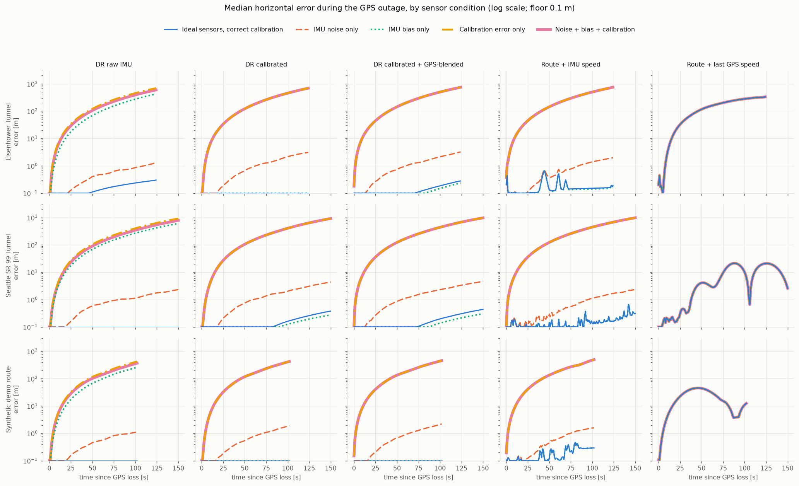
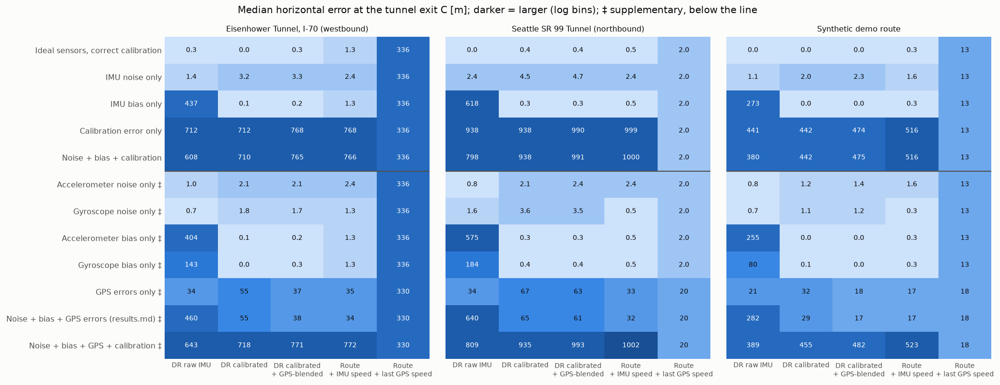

# Sensor-factor baseline: how each imperfection affects the existing estimators

Study of 2026-10-13. It is a baseline for understanding, **not** a ranking or an optimisation of the
estimators. No estimator was changed for it. Reproduce with (about 12 min; figures need the dev
dependency matplotlib):

```bash
uv run python -m throughtunnel.evaluation.factor_study --seeds 20 --out docs/factor_study
```

Generated outputs in [factor_study/](factor_study/):
* `tables.md`: all tables for all presets;
* `runs.csv`: 3,600 rows, one per run, condition and estimator;
* `curves.csv`: median error vs time since GPS loss;
* the two figures shown below.

## 1. Design

* **Identical drives.** The three presets use their own drive: Eisenhower (2.7 km, nearly straight,
  125 s of dead reckoning to C), Seattle (3.0 km, 151 s) and synthetic (2.0 km, curvy, 104 s).
* **Identical seeds.** Run k (k = 0…19) uses sensor and GPS seed k in **every** condition. Each error
  source has its own random stream, so a source that is on in two conditions has the identical
  realisation in both. GPS availability (loss point, reacquisition) has its own stream, so the outage
  is identical across the conditions of a run. Both properties are tested
  (`tests/test_factor_study.py`).
* **Main conditions**, as requested. GPS is error-free in all five, so only the IMU-side factor
  differs:

| condition | IMU noise | IMU bias | calibration error |
|---|---|---|---|
| Ideal sensors, correct calibration | off | off | off |
| IMU noise only | 180 µg/√Hz, 7 mdps/√Hz | off | off |
| IMU bias only | off | 10 mg, 0.1 °/s (random direction per run) | off |
| Calibration error only | off | off | yaw 2°, pitch 0.5°, roll 0.5° (D34 default) |
| Noise + bias + calibration | on | on | on |

* **Supplementary conditions** (‡). They are not requested, but needed to explain the main ones:
  * accelerometer vs gyroscope, separately for noise and bias;
  * GPS errors only;
  * noise + bias + GPS errors, i.e. the `results.md` setting;
  * everything together.
* **Consistency check.** The "noise + bias + GPS errors" condition reproduces the same-drive table
  of `results.md` §2.2 exactly, e.g. Eisenhower 459.8 / 54.8 / 38.3 / 34.0 / 330.2 m.
* **Metrics** (against the true phone position):
  * error at C, total and its along/cross-track parts;
  * median error vs time since GPS loss;
  * growth exponent p from e(t) ∝ t^p between 30 s and 90 s;
  * exit-announcement timing.

## 2. Results





**Median horizontal error at C [m], main conditions** (20 runs; p90 and all other tables in
`factor_study/tables.md`):

| condition | dr_raw | dr_calibrated | dr_filtered | route_imu | route_hold |
|---|---|---|---|---|---|
| *Eisenhower* | | | | | |
| ideal | 0.3 | 0.0 | 0.3 | 1.3 | 336 |
| IMU noise only | 1.4 | 3.2 | 3.3 | 2.4 | 336 |
| IMU bias only | 437 | 0.1 | 0.2 | 1.3 | 336 |
| calibration error only | 712 | 712 | 768 | 768 | 336 |
| noise + bias + calibration | 608 | 710 | 765 | 766 | 336 |
| *Seattle* | | | | | |
| ideal | 0.0 | 0.4 | 0.4 | 0.5 | 2.0 |
| IMU noise only | 2.4 | 4.5 | 4.7 | 2.4 | 2.0 |
| IMU bias only | 618 | 0.3 | 0.3 | 0.5 | 2.0 |
| calibration error only | 938 | 938 | 990 | 999 | 2.0 |
| noise + bias + calibration | 798 | 938 | 991 | 1000 | 2.0 |
| *Synthetic* | | | | | |
| ideal | 0.0 | 0.0 | 0.0 | 0.3 | 13 |
| IMU noise only | 1.1 | 2.0 | 2.3 | 1.6 | 13 |
| IMU bias only | 273 | 0.0 | 0.0 | 0.3 | 13 |
| calibration error only | 441 | 442 | 474 | 516 | 13 |
| noise + bias + calibration | 380 | 442 | 475 | 516 | 13 |

**Supplementary conditions, error at C [m]** (Eisenhower / Seattle / synthetic):

| condition | dr_raw | dr_calibrated | dr_filtered | route_imu | route_hold |
|---|---|---|---|---|---|
| accelerometer noise only ‡ | 1.0 / 0.8 / 0.8 | 2.1 / 2.1 / 1.2 | 2.1 / 2.4 / 1.4 | 2.4 / 2.4 / 1.6 | = ideal |
| gyroscope noise only ‡ | 0.7 / 1.6 / 0.7 | 1.8 / 3.6 / 1.1 | 1.7 / 3.5 / 1.2 | = ideal | = ideal |
| accelerometer bias only ‡ | 404 / 575 / 255 | ≤ 0.3 | ≤ 0.3 | = ideal | = ideal |
| gyroscope bias only ‡ | 143 / 184 / 80 | ≤ 0.4 | ≤ 0.4 | = ideal | = ideal |
| GPS errors only ‡ | 34 / 34 / 21 | 55 / 67 / 32 | 37 / 63 / 18 | 35 / 33 / 17 | 330 / 20 / 18 |
| noise + bias + GPS ‡ | 460 / 640 / 282 | 55 / 65 / 29 | 38 / 61 / 17 | 34 / 32 / 17 | 330 / 20 / 18 |

**How the error grows** (growth exponent p, e ∝ t^p, between 30 s and 90 s; Eisenhower / Seattle):

| factor | estimators affected | p | what it means |
|---|---|---|---|
| IMU bias | dr_raw | 2.0 / 2.0 | constant acceleration or turn-rate error |
| calibration error | all IMU estimators | 1.7–1.9 | gravity leakage, a constant forward acceleration error |
| GPS errors | calibrated, route_imu | 1.0–1.4 | mostly a constant speed/heading error handed over at GPS loss |
| IMU noise | all IMU estimators | (below 0.5 m at 30 s) | random walk; theory gives p = 1.5 |

**Exit announcement (300 m before C), median timing error [s]:**
* ideal, noise or bias: ≤ 0.1 s for the calibrated estimators;
* calibration error: **18–21 s** for every IMU estimator, i.e. effectively missed (see finding 7);
* `route_hold`: 12.6 / 0.8 / 0.2 s, independent of the sensors.

## 3. Findings

1. **Without sensor errors, the inertial methods are exact; the naive reference is not.**
   * In the ideal condition every IMU estimator is within about 1 m. The small spikes of
     `route_imu` are the map polyline vs the driven path, not a sensor effect.
   * `route_hold` is off by 336 m (Eisenhower), 2 m (Seattle) and 13 m (synthetic) **with perfect
     sensors**. Its error is purely a model error: it holds the speed while the driver changes it.
     None of the sensor factors touches it except GPS speed noise.
2. **IMU noise alone is harmless: 1–5 m at C, and it behaves as theory predicts.**
   * Accelerometer white noise is a velocity random walk, i.e. along-track error. Gyroscope noise
     is an angle random walk, i.e. cross-track error.
   * The measured spreads match the closed-form random-walk values, N·τ^1.5/√3 and v·N·τ^1.5/√3, within
     sampling error. Example (Eisenhower, `dr_raw`): along-track 1.23 m vs 1.44 m predicted;
     cross-track 1.53 m vs 2.18 m predicted, while the realised heading spread of those 20 runs was
     itself 0.82× the predicted value.
   * `route_imu` is immune to gyroscope noise: it takes its heading from the map.
3. **Unexpected: calibration turns noise into bias.** Under noise only, the calibrated estimators are
   1.5–3× *worse* than the uncalibrated `dr_raw` (e.g. Seattle 4.5 vs 2.4 m).
   * The approach-phase calibration estimates constants from noisy data: the levelling tilt and the
     gyro bias. Their small estimation error is then applied as a *constant* for the whole outage,
     so it grows quadratically instead of as a random walk.
   * Order-of-magnitude check: levelling over ~70 s of approach leaves a tilt error of about
     N/√T ≈ 2·10⁻⁴ m/s². That gives ½·b·τ² ≈ 1.7 m at C, the size of the observed excess.
   * The same mechanism, much larger, appears with GPS errors (finding 5).
4. **IMU bias alone ruins raw dead reckoning but is fully calibrated away.**
   * `dr_raw`: 273–618 m. The accelerometer bias dominates (255–575 m, along-track, p = 2.0). The
     gyroscope bias adds 80–184 m, mostly cross-track.
   * Calibrated estimators: ≤ 0.4 m. The levelling absorbs the horizontal accelerometer bias, and
     the regression against GPS bearings removes the gyroscope bias.
   * **This is optimistic.** It relies on a flat road (R1), a constant bias (no drift, R5) and, in
     this condition, error-free GPS. With GPS errors the same calibration is far less exact
     (finding 5).
5. **In the realistic default, the calibrated estimators are limited by GPS, not by the IMU.**
   * "Noise + bias + GPS errors" is practically equal to "GPS errors only" for `dr_calibrated`,
     `dr_filtered` and `route_imu` (e.g. Seattle 65 vs 67, 61 vs 63, 32 vs 33 m). The 16–34 m of the
     main results come from GPS errors.
   * Two GPS paths cause it:
     * the speed and heading handed over at the tunnel entrance (a constant error, linear growth,
       p ≈ 1.0–1.4);
     * a calibration made from noisy GPS: levelling with Δv/Δt from noisy speeds, gyro bias from noisy
       bearings.
   * Hence `dr_calibrated` is *worse* than `dr_raw` with GPS errors only (55 vs 34 m on Eisenhower).
     GPS speed blending (`dr_filtered`, `route_imu`) recovers part of it.
   * **Consequence for improving the estimators: better use of approach GPS (calibration and
     hand-over) matters more than a better IMU model.**
6. **Calibration error dominates everything else.**
   * The D34 default (pitch 0.5°) adds 0.4–1 km for every IMU estimator, growing about quadratically
     (p ≈ 1.7–1.9), as quantified in [calibration_error.md](calibration_error.md).
   * The route constraint offers no protection, and the GPS-blended estimators are slightly worse.
   * "Noise + bias + calibration" ≈ "calibration error only": once the pitch leaks gravity, noise
     and bias are invisible.
   * The result depends strongly on the assumed residual: 0.05° of pitch is about ten times smaller in
     effect (calibration_error.md).
7. **Negative result: the exit announcement fails as soon as the estimate lags by more than the
   announcement distance.**
   * With the calibration error, every IMU estimator is 400–1000 m behind at C, so it reaches
     "300 m before C" only after GPS returns. The announcement then comes 18–21 s late, after the
     driver has left the tunnel.
   * The timing error saturates at about d/v + reacquisition delay instead of growing further, so the
     *timing* metric understates the failure. It is a missed announcement, not a late one.
8. **Errors do not simply add.** For `dr_raw`, "noise + bias + calibration" (608 m) is *smaller* than
   "calibration error only" (712 m).
   * The bias direction is random. In some runs its forward component points against the gravity
     leakage and cancels part of it.
   * This is a coincidence of signs, not an improvement: the median falls, the p90 rises. It is a
     reminder to report factors separately, not only combined.

**Sensitivity summary** (which factor dominates, per method, in this setting):

| method | dominant | moderate | negligible |
|---|---|---|---|
| dr_raw | accelerometer bias, calibration error | gyroscope bias, GPS hand-over | noise |
| dr_calibrated, dr_filtered | calibration error (pitch) | GPS errors (via hand-over and calibration) | noise, bias (calibrated away) |
| route_imu | calibration error (pitch, slightly amplified by blending) | GPS errors | gyroscope noise and bias (map heading), accelerometer noise, accelerometer bias |
| route_hold | drive dynamics (model error) | GPS speed noise | all IMU factors |

## 4. Limitations

* One drive per preset; 20 runs per condition. The medians are stable to a few per cent where errors
  are large; below about 2 m they are dominated by sampling noise.
* Flat road, rigid mount, constant bias, white noise, error-free map (D05). These choices make the
  calibration look better than it would be on real roads (findings 3–5).
* The calibration error is the fixed D34 default. Its size is an assumption (calibration_error.md
  covers 0.05–0.5°).
* GPS errors are only in the supplementary conditions; the main conditions isolate the IMU side.
