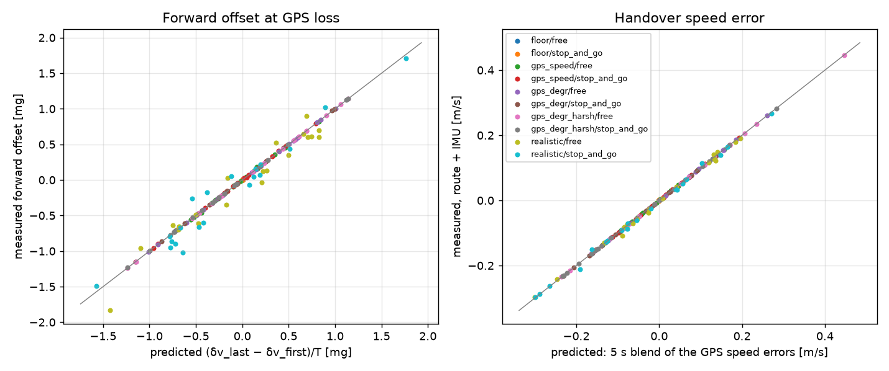

# Handover diagnostic: where the state handed over at GPS loss comes from

Diagnostic of 2026-10-16, step 0 of [estimator_plan.md](estimator_plan.md). **No estimator was changed.**
The error-source benchmark ([benchmark/README.md](benchmark/README.md)) showed that the state handed
over at GPS loss (forward offset and speed error) sets the error 5 km in. This diagnostic asks where
that state comes from, so step 1 attacks the right thing.

Generated tables: [handover_study/tables.md](handover_study/tables.md). Per-run data:
`handover_study/diagnostic.csv`. Module: `evaluation/handover_study.py`.

    uv run python -m throughtunnel.evaluation.handover_study --out docs/handover_study

## Hypothesis (from the code)

The levelling of the GPS + IMU calibration (`mount_estimation.py`) takes the up axis as the mean of
"measured specific force − predicted vehicle acceleration" over every GPS interval of the approach, with
the forward part predicted as Δv_GPS/Δt. Summed over the approach, the Δv cancel pairwise, so only the
first and the last GPS speed are left:

    forward offset b ≈ (δv_last − δv_first) / T        δv = GPS speed error, T = approach time used

The 5 s GPS blend of the estimators then hands over an exponential average of the last few δv. If this
holds, the same last fixes set both terms of the error ½·b·t² + δv·t.

## Method

* The error-source benchmark's conditions in which GPS speed errors act: floor, GPS speed noise, GPS
  degradation (normal, harsh) and realistic, in free flow and stop-and-go, 20 seeds each (200 runs).
  The simulation and the calibration are rerun. The estimator results (handover speed, error 5 km in)
  are joined from the benchmark's `runs.csv`. The source code is unchanged since that baseline (checked
  with `git diff`). The rerun reproduces its forward offsets exactly (difference 0).
* Per run: the measured forward offset at GPS loss, its prediction from the GPS speed errors of the
  calibration's intervals, and the handover speed error predicted by replaying the 5 s blend on the GPS
  speed errors.
* A formula prediction for solutions 1a + 2a: the calibration and speed frozen at the last fix 200 m
  before B, the speed carried to B with the frozen offset.

## Findings

1. **The hypothesis holds exactly.** The forward offset equals (δv_last − δv_first)/T. Correlation 1.00,
   slope 1.00 in every GPS condition, with residuals of 0.000–0.008 mg. In the realistic setting the GPS
   part explains it with correlation 0.97–0.98; the rest (0.17 mg rms) is IMU error absorbed by the
   levelling.
   * The calibration uses only the approach: **T = 82–84 s** in these scenarios (about 1.6 km at
     70 km/h). The offset scales with 1/T, so a longer approach would shrink it in proportion.
   * With speed noise on every fix, the **first** fix counts as much as the last: the last fix alone
     correlates only 0.52–0.65.
   * Degradation affects only the fixes near B, so there the last fix alone explains everything (1.00).
     This explains why harsh degradation is barely worse than normal: only the last fix's speed error
     counts, not the length of the degraded stretch.
2. **The handover speed is the 5 s blend of the last GPS speed errors** (correlation 1.00, slope
   1.00, both estimators). The blend reduces the last fix's error by about 3.5×: 0.39 → 0.11 m/s
   median in the realistic setting.
3. **In free flow the offset dominates.** The offset term ½·b·t² is 79–194 m (median) against
   12–38 m for the speed term. Both come from the same last fixes, so they mostly have the same sign
   (15–18 of 20 runs; correlation of δv and b: 0.5–0.8) and add up.
4. **Correction: in stop-and-go the formula does not hold.** The error-source write-up says the error
   5 km in is ½·b·t² + δv·t with correlation 0.99–1.00. That check was run in free flow only. In
   stop-and-go the correlation is 0.80–0.94, but the formula overshoots 3–5× (slope 0.18–0.31). The
   reason is the v ≥ 0 clamp (P5):
   * **Negative offsets:** the clamp resets the speed error at every stop, so the error is only
     12–20 % of the formula.
   * **Positive offsets:** they keep creeping, at 51–94 % of the formula.

   This is direct evidence for P5. The one-sided stop already removes most of the error of the runs
   it acts on. A two-sided version (standstill detection, 5a) should do the same for the positive
   runs.
5. **A lead for the 12–13 m stop-and-go floor (step 2).** With error-free sensors, the stop-and-go
   floor runs carry a tiny **positive** forward offset (≈ 0.004 mg, all 20 runs) that the GPS does not
   explain (δv = 0). Over 738 s it predicts the floor: 11 m predicted vs. 13 m measured, correlation
   0.99. In free flow the same offset is ≈ 0.0002 mg. So the floor is mainly a calibration offset, not
   the stop handling. The 42 m residual is also a steady forward offset (≈ 0.03 mg), so the two may
   share a cause in the levelling on the approach.

## What this means for step 1 (1a + 2a)

Formula prediction, free flow, 5 km, route + IMU, |error| median (p90):

| condition | now | calibration + speed frozen 200 m before B |
|---|---|---|
| GPS degradation (150 m) | 190 m (347) | 0 m (0) |
| GPS degradation, harsh (500 m) | 200 m (422) | 129 m (256) |
| GPS speed noise only | 87 m (172) | 82 m (272) |
| realistic | 218 m (340) | 109 m (236) |

* **Freezing removes the degradation if the freeze point lies before it.** The 150 m case vanishes
  only by construction (its errors exist only in the last 150 m). The harsh case starts 500 m before
  B, so a 200 m freeze removes only part of it. A fixed distance has to guess the length of the
  degraded stretch.
* **Realistic free flow: about 220 → 110 m predicted.** That is a halving, not the 50–80 m the plan
  expected. What remains is the endpoint noise of ordinary GPS speed: the freeze fix is just another
  noisy last fix, and the "GPS speed noise only" row does not improve.
* **The cause, not the symptom, is the endpoint form of the levelling.** A least-squares fit of the
  forward offset over all fixes (the slope of GPS speed − integrated forward IMU, "1e") averages the
  noise of every fix. For N equally spaced fixes the fitted slope's noise is √(6/N) of the endpoint
  difference's: about 0.27 for N = 82. That should cut the speed-noise offset term about fourfold. This
  is theory, not tested. It is the offset state of the planned Kalman filter (3d) in small, and it
  could be combined with a freeze to drop the degraded fixes.

## Limits

* The 1a + 2a numbers are formula predictions in free flow. They assume the IMU part of the offset
  stays as it is, and they ignore the position error at B during the frozen stretch.
* T is set by the scenario (the approach A–B). Real drives may calibrate over a longer GPS history,
  which helps, unless the phone moves in its holder.
