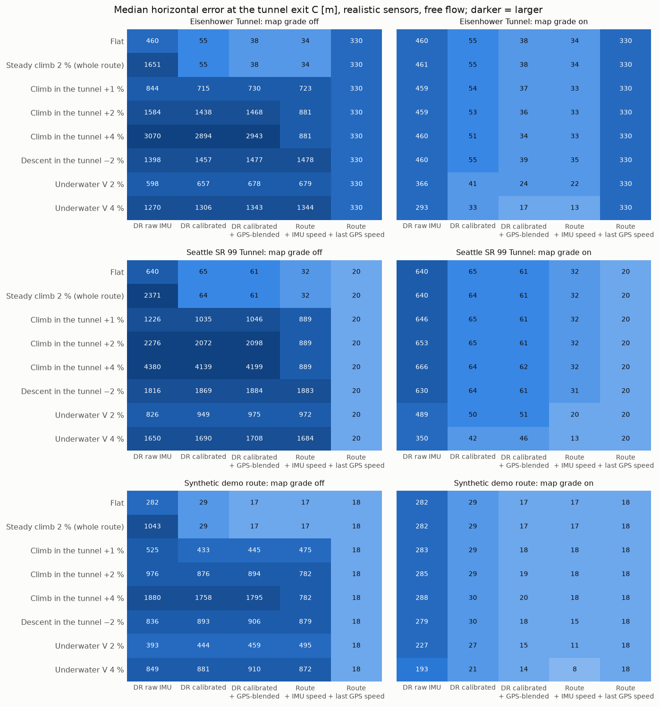
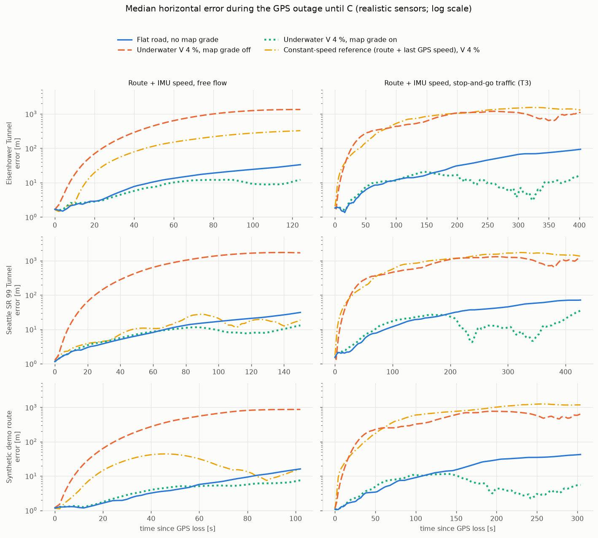

# Map grade: effect of the road grade from the map on the estimators

Study of 2026-10-15 (D39). The slope study showed that a grade *change* after the approach
calibration costs the IMU estimators 0.4–1.0 km at C per 1 % ([slope_study.md](slope_study.md)). Here
the navigation map provides the road grade (an option, assumed exact), and the estimators remove the
gravity it adds to the forward accelerometer axis.

Generated tables: [map_grade_study/tables.md](map_grade_study/tables.md). Per-run data:
`map_grade_study/runs.csv`. Figures below.

## Method

* **Map data.** With `map_data.road_grade` on, `RouteMap.road_grade` holds the grade every 10 m along
  the map route: the true grade at the closest point of the driven path. The map carries the grade
  itself, not heights. Differentiating heights over *map* distance shows false grade dips (≈0.26 %)
  wherever the driven path cuts a polyline corner, because map and driven distance diverge by 1–3 m
  there. In validation, those dips biased the calibration grade and cost 23 m on a steady climb that
  should cost nothing.
* **Correction.** Every IMU estimator subtracts g·sin(φ(d̂) − φ_cal) from the forward specific force.
  * φ(d̂) is the map grade angle at the estimator's own along-route distance.
  * φ_cal is the mean map grade over the GPS intervals the alignment calibrated on. The levelling has
    already absorbed that grade, so only the change since calibration is removed.
  * `dr_raw` does no levelling, so its φ_cal = 0.
  * `route_hold` uses no IMU and is unchanged (verified: identical in every run).
* **Design.**
  * Each simulated run is evaluated with the grade off and on. The switch is information for the
    estimators only, so the drive, sensor data and GPS are identical (paired).
  * **Free flow:** the eight profiles of the slope study, with the same sensors and seeds, so "off"
    reproduces the slope study.
  * **Stop-and-go (T3):** four of the profiles (flat, +2 %, −2 %, underwater V 4 %). This was the case
    flagged as worst in the traffic study.
  * Sensors: *ideal* (error-free IMU and GPS, one run) and *realistic* (preset errors, 20 paired
    seeds; run k uses seed k for the sensors, the GPS and the traffic).
  * Three presets: 7 560 records in total.

## Results

### 1. Free flow: the map grade turns a sloped tunnel back into a flat one

Realistic sensors, error at C, median (p90) [m], map grade off / on:

| preset, profile | dr_calibrated | dr_filtered | route_imu |
|---|---|---|---|
| Eisenhower, flat | 55 (76) | 38 (60) | 34 (55) |
| Eisenhower, climb +2 % | 1438 (1514) / 53 (75) | 1468 (1518) / 36 (60) | 881 § / 33 (57) |
| Eisenhower, climb +4 % | 2894 (2970) / 51 (79) | 2943 (2992) / 34 (60) | 881 § / 33 (59) |
| Eisenhower, descent −2 % | 1457 (1502) / 55 (80) | 1477 (1514) / 39 (60) | 1478 (1514) / 35 (53) |
| Seattle, flat | 65 (116) | 61 (93) | 32 (72) |
| Seattle, climb +4 % | 4139 (4212) / 64 (111) | 4199 (4241) / 62 (93) | 889 § / 32 (77) |
| Seattle, underwater V 4 % | 1690 (1723) / 42 (91) | 1708 (1734) / 46 (86) | 1684 (1714) / 13 (19) |

§ = capped by the route end in every run.

* **The gravity leakage is gone.** Paired against the same run on the flat road, the calibrated IMU
  estimators with map grade are within a few metres. For climbs and descents in the tunnel the
  median is within ±2 m and the p90 at most +8 m, on all presets. Without map grade, the same profiles cost
  0.4–4.2 km.
* **The exit announcement recovers too.** With map grade on, the median timing error is 0.3–1.9 s,
  back at the flat-road values; without it, it was 10–58 s.
* **`dr_raw`** returns to its own flat-road result (280–640 m, limited by the uncorrected accelerometer
  bias). On a steady climb it gains the most, because it never levels.
* **With ideal sensors**, every IMU estimator ends 0–7.6 m from the truth at C on every profile,
  compared with 0.4–4.2 km without map grade.

### 2. Grade changes act as a weak position measurement

The underwater V profiles with map grade are *better* than the flat road: by 3–23 m median for the
calibrated estimators. A mechanism consistent with the pattern (an interpretation, not separately
tested):

* **The estimator looks up the grade at its *estimated* position.** At a grade change, a position
  error Δs therefore becomes a speed change of about g·Δgrade·Δs/v over the transition. Example:
  20 m ahead at 20 m/s through a 4 % change gives 0.4 m/s.
* **Where the grade increases, this pulls the estimate back.** An estimate that is ahead looks up the
  steeper grade, subtracts too much, and slows down.
* **Where the grade decreases, it pushes the estimate further away.**
* **The V has two increases in mid-tunnel**, where position errors are already sizeable. The climb
  profiles have their increase at the entrance, where the error is still near zero, so they show no
  gain.

This is free position information that the current estimators exploit only by accident. A future
estimator could use grade changes explicitly, as "vertical map matching", like A7 for turns.

### 3. Stop-and-go: the bulk is removed, but long outages leave tails

Realistic sensors, error at C, median (p90) [m], map grade off / on:

| preset, profile | dr_calibrated | dr_filtered | route_imu |
|---|---|---|---|
| Eisenhower, flat | 142 (596) | 118 (532) | 115 (530) |
| Eisenhower, climb +2 % | 19021 (25983) / 170 (1310) | 19100 (26203) / 126 (1013) | 881 § / 122 (881 §3) |
| Eisenhower, underwater V 4 % | 5546 (7843) / 78 (276) | 5534 (7832) / 46 (123) | 881 § / 22 (117) |
| Seattle, flat | 228 (450) | 199 (433) | 86 (366) |
| Seattle, climb +2 % | 21099 (29251) / 228 (641) | 21305 (29388) / 199 (618) | 889 § / 93 (597) |
| Synthetic, underwater V 4 % | 3914 (5309) / 42 (84) | 3902 (5316) / 24 (51) | 782 § / 13 (27) |

* **The flagged catastrophe is averted.** The case "traffic × slope", estimated at kilometres in the
  traffic study, measured 11–21 km at C on a +2 % climb without map grade. With map grade the median
  is 52–228 m, close to the flat-road median.
* **The tails remain.** Paired against the flat road, the p90 rises by up to +695 m (Eisenhower +2 %,
  `dr_calibrated`). Traffic makes outages 3.2–3.6× longer (364–486 s), so position errors reach hundreds of
  metres. A grade *decrease* near C then amplifies them (mechanism 2, with Δs/v large at low speed; an interpretation):
  * an estimate ahead of the truth reaches the flat section early;
  * it stops subtracting the leakage while the vehicle is still climbing;
  * so it accelerates further ahead.
* The constant-speed reference `route_hold` stays at the route end in stop-and-go (unchanged).

### 4. What the map grade does not fix

* **Time-driven drift.** The residual calibration error and the bias drift during long outages
  (traffic study) are untouched. The flat-road numbers are the ceiling.
* **Exact map assumed.** Map grade errors (noise, offset, smoothing, a profile shifted along the
  route) are not modelled, by decision; they are listed in [limitations.md](limitations.md). A
  shifted profile acts like a position error at every grade change (mechanism 2), and every 0.1 % of
  grade error leaks 0.1 % of g into the speed.

## Open items

* **An unexplained residual with ideal sensors in long outages.** Eisenhower stop-and-go +2 %: 42 m at
  C (flat: 7 m). It is a steady speed error of ~3·10⁻⁴ m/s², present even at standstill.
  * The estimator's standard gravity (simulator: normal gravity at the latitude) accounts for 14 m of
    it, but with the opposite sign. With matched gravity the residual is 56 m.
  * Another term of the same size is therefore unidentified (candidates: second-order terms of the
    levelling on the grade transition during the approach).
  * Small against the realistic results (52–228 m median), but worth resolving before an estimator
    claims sub-50 m in long outages.
* The second-order terms are listed in `positioning/map_grade.py`.

## Reproduce

    uv run python -m throughtunnel.evaluation.map_grade_study --seeds 20 --out docs/map_grade_study

About 50 min with two workers. `--from-csv` regenerates the tables and figures from a saved run.
