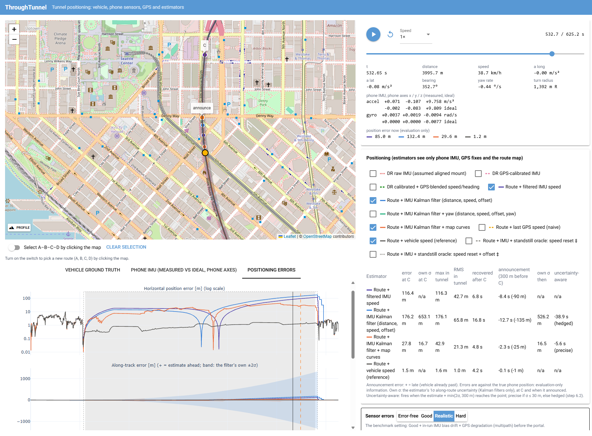
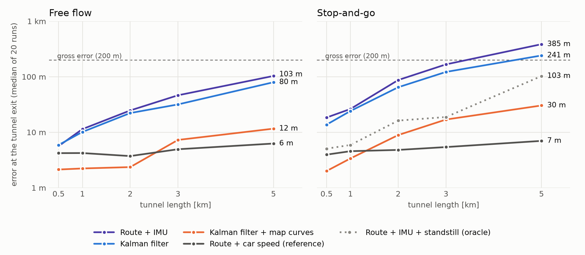

# Through the Tunnel: keeping a phone's position through a GPS outage

## Summary

A phone in a car loses GPS in a 0.5–5 km tunnel and still has to show the car's position, call out the
exit on time and recover afterwards. A simulator was built that produces the phone's sensor data on
real and synthetic tunnel drives, and position estimators were developed on it step by step, each
change checked against fixed benchmarks.

* **The route turns the problem into one number:** how far along the route the car is. That depends
  on the speed, which inside the tunnel can only come from integrating the accelerometer, so small
  errors grow with the square of time (a 0.1° tilt error costs about 550 m after 5 km).
* **The error is decided before the tunnel.** In free flow, the speed and forward offset handed over
  at GPS loss predict the error at the exit almost exactly. Freezing the calibration before the portal,
  fixing small calibration biases and a Kalman filter that learns the offset cut the error at 5 km by
  half or more and made tilt errors harmless.
* **Inside the tunnel, only new information stops the error from growing.** Curves on the map, matched
  against the gyroscope's heading, keep the error at 12–30 m after 5 km in curved tunnels, even in
  stop-and-go. In nearly straight tunnels with stop-and-go traffic, phone-only estimation still fails
  in a large share of runs.
* **Information outside the phone is worth a lot:** the car's speed gives 4–7 m everywhere, and stop
  detection would help in jams, but only if the restart is caught in well under half a second.
* **On slopes, the road grade from the map is essential**; without it, inertial methods fail.
* **The exit announcement follows the position.** Using the filter's uncertainty removes late
  announcements, at the price of early, hedged ones in slow traffic.

Error at the tunnel exit on the 5 km benchmark tunnel (median of 20 runs):

| Estimator | Free flow | Stop-and-go |
|---|---|---|
| Route + IMU, before the improvements | 231 m | 482 m |
| Route + IMU, final (portal freeze, calibration fixes) | 103 m | 385 m |
| Kalman filter | 80 m | 241 m |
| **Kalman filter + map curves** (best phone-only) | **12 m** | **30 m** |
| Route + car speed (reference) | 6 m | 7 m |

All results come from simulation with an exact map, and the synthetic tunnels are curved by
construction, which favours the map curves; section 6 discusses what that means.

## 1. The problem and its interpretation

A driver is following turn-by-turn directions on a phone when the road enters a long tunnel. GPS fades
within seconds and stays gone for up to several minutes, yet the navigation app must still show the car
in the right place, call out the exit at the right moment, and recover cleanly when the car comes out.
This case study asks how far the phone's own sensors can carry the position through the outage, and
where that stops being enough. To answer it, a simulator was built and the estimators were developed
step by step against a fixed benchmark.

Every drive follows the same structure along the route, and the letters are used throughout:

```
A ───── GPS ───── B ═══════ tunnel, no GPS ═══════╪═══════ C ───── GPS ───── D
start             entrance                  announcement   exit              end
                                          (300 m before C)
```

### What the app is assumed to know

| Topic | Assumption | Why |
|---|---|---|
| Route | The app knows the planned route as a map polyline, and where the tunnel starts (B) and ends (C). The car follows the route. | A navigation app has both. Together they turn the problem into one dimension: how far along the route the car is. |
| Call-out | One announcement a set distance before the tunnel exit (default 300 m), triggered from the estimated position while GPS is still absent. | "Call out an exit inside the tunnel" is read as an instruction given inside the tunnel, for a manoeuvre at or after the exit. Any other point at a known distance along the route works the same way. |
| Phone | Fixed in a holder for the whole drive, at an unknown angle that is estimated from the approach. | People mount phones in all sorts of ways. A phone picked up inside the tunnel is out of scope. |
| GPS | The phone's location fixes at 1 Hz (position, speed, bearing, reported accuracy), not raw GNSS. Lost shortly before the entrance, back a few seconds after the exit. | This is what a navigation app receives. |
| Phone sensors used | GPS, accelerometer and gyroscope. | The magnetometer is disturbed by the tunnel's steel and electrical installations, and tunnel ventilation and traffic disturb the barometer. |
| Road grade | Optional: the road's slope along the route, taken from the map and assumed exact. | Without it, inertial methods fail on sloped roads (section 5). |
| Information from outside the phone | The car's own speed reading (OBD, CarPlay / Android Auto) and a perfect standstill signal are given only to separately labelled estimators, never to the phone-only ones. | They show what that extra information would be worth, without mixing it into the phone-only results. |
| Tunnel | Single lane: no lane changes, no junctions inside. | Given by the brief. |

### Why it is hard

No phone sensor measures speed or position inside a tunnel. Speed has to come from integrating the
forward accelerometer, so any constant error in it grows with the square of time in the position:

* **1 mg** of uncorrected forward offset, a tenth of the accelerometer bias simulated for a phone,
  becomes about **330 m** over a 5 km tunnel at 70 km/h (258 s without GPS);
* a **0.1° tilt error** in the phone's estimated orientation leaks 1.7 mg of gravity into the forward
  axis, which costs about **550 m** at the end of the same tunnel, as the
  [error-source benchmark](benchmark/README.md#what-the-error-source-benchmark-says) shows;
* a **1 % change in road grade** that the estimator does not know about leaks 10 mg, and costs
  0.4–1 km at the exit of the 2–3 km preset tunnels ([slope study](slope_study.md));
* in **stop-and-go traffic** the same 5 km takes 738 s instead of 258 s, so the same offset acts
  almost three times as long, and its effect grows with the square of time.

The gyroscope's heading matters far less: once the estimate is held on the route, the map bounds the
cross-track error. What remains, and what the rest of this report is about, is **how far along the
route the car is**, and therefore how well its speed is known.

## 2. The simulator

The simulator produces what a phone in a car would record on a drive through a tunnel, together with
the true motion of the car, which is hidden from the estimators and used only to score them. The same
Python core runs behind an interactive browser app and behind the batch benchmarks.

### A drive through a tunnel

A scenario is a route through four points: the start A, the tunnel entrance B, the tunnel exit C and
the end D. The approach A–B has GPS, the tunnel B–C has none, and C–D shows the recovery. The route can
be a real road from OpenStreetMap or a synthetic one; the tunnel itself is simulated by switching GPS
off between B and C. Three scenarios are bundled: the Seattle SR 99 tunnel (3.0 km) and the Eisenhower
tunnel (2.7 km) on their real road geometry, and a synthetic demo route (2.0 km). The benchmark adds
synthetic tunnels of 0.5–5 km.

The car drives a smoothed version of the map's polyline (at most about 1 m from it), while the
estimators receive the original polyline, so the map is close to the truth but not identical. A driver
model varies the speed smoothly, brakes for curves and respects acceleration and jerk limits, and the
motion is integrated exactly. Two optional features make the drive harder:
* **Road grade:** an editable elevation profile (templates: steady climb, climb inside the tunnel,
  underwater tunnel), with the car moving in 3-D;
* **Traffic:** a slowdown at the portal, a speed limit in the tunnel, stop-and-go with real stops, a
  queue at the exit, or congested flow.

### What the phone records

| Source | Model | Default ("Realistic" level) |
|---|---|---|
| Accelerometer and gyroscope | Specific force (including gravity and the lever arm) and turn rate in the phone's own axes, with the phone mounted at any angle. White noise, constant bias and an optional slowly drifting bias. | 200 Hz; noise 180 µg/√Hz and 7 mdps/√Hz; bias 10 mg and 0.1 °/s; drift 0.5 mg and 5 mdps with a 5 min correlation time |
| GPS | Location fixes of the phone: position, speed, bearing and reported accuracy. Time-correlated position error and speed noise. Lost up to 30 m before B, back 3–5 s after C. Optionally degraded just before the entrance, with larger errors and multipath jumps. | 1 Hz; 2.5 m correlated + 0.5 m white; 0.2 m/s; degradation over the last 150 m, up to 8 m extra error and 5 % jumps |
| Route map | The polyline with B, C and the announcement point; optionally the road grade. | grade exact when enabled |
| Car speed reading (reference estimator only) | The car's own speed with a fixed scale error. | 10 Hz, +2 % |
| Standstill signal (oracle estimators only) | The exact moments the car stops and starts again. | perfect |

The noise densities are the typical values of a common smartphone IMU (Bosch BMI160). The bias and
drift values are assumptions; a constant bias is removed almost completely by the calibration, so its
size hardly affects the results.

One control sets all sensor errors together, at four levels:
* **Error-free:** no errors; the limit of the algorithms themselves;
* **Good:** sensor noise and bias, clean GPS up to the entrance;
* **Realistic:** Good plus bias drift and GPS degradation before the entrance; the benchmark setting;
* **Hard:** Realistic plus an error in the phone orientation the estimators use (yaw 2°, pitch 0.5°,
  roll 0.5°), applied after their own orientation estimate, since a fixed rotation in the sensor data
  would simply be estimated and removed.

### Keeping the comparison fair

* **The truth stays hidden:** estimators receive only the sensor streams and the map, and a test checks
  that the positioning code loads no part of the simulator.
* **No look-ahead:** observations are fed in time order, and a test checks that changing future data
  never changes earlier estimates.
* **Paired runs:** every random error has its own seeded stream, so switching one source on or off
  leaves the others unchanged and every estimator sees the same data; a saved scenario replays bit for
  bit.
* **Checked physics:** 348 automated tests; for example, the simulated IMU matches the numerically
  differentiated motion of a tilted phone on a lever arm to 0.0005 m/s².

### The app



The browser app plays a drive back with the true car and every estimator on the map, and lets the
mounting, sensor errors, grade, traffic and announcement distance be changed live, with error plots and
a summary table following every change ([README](../README.md)).

Some effects are deliberately left out, notably vibration, map errors and a phone moved during the
drive; section 6 discusses them, and the [full list](limitations.md) gives the expected effect of each.

## 3. Approach

The method was built up in layers. Each layer was added only after the benchmark (section 4) had shown
the problem it addresses, and was kept only if it measurably helped.

### The pipeline

```
GPS fixes ─┐
IMU ───────┼─► calibration ──────────► estimator ─────────► position on the route ± σ
route map ─┘   phone orientation,      distance along           → map display
               sensor biases           the route, speed, …      → exit announcement
```

**Calibration.** On the approach, the phone's orientation in the car is learned from GPS: the up
direction from gravity, the forward direction from the speed changes and turns seen by GPS, and the
gyroscope bias from the GPS bearing. This removes a tilted mount and constant sensor biases almost
completely. The main thing left is a small residual tilt, which looks exactly like a forward
acceleration: the error of section 1.

**Estimator.** All main estimators work along the route, which removes the heading drift and the
cross-track error and leaves only the distance along the route to estimate. The simplest version
advances it with the last GPS speed, the next with the calibrated forward acceleration. Two-dimensional
dead reckoning without the route was built first and dropped once the route-constrained versions proved
better.

**Road grade.** On a slope, gravity leaks into the forward axis. When the map provides the grade, every
IMU-based estimator subtracts the leak of the grade change since the calibration. Without it a sloped
tunnel costs 0.8–25 km at the exit; with it, sloped tunnels in free flow are about as accurate as flat
ones ([map grade study](map_grade_study.md)).

### From problems to solutions

The benchmarks pointed to one problem at a time. The table lists each, the change it led to, and the
clearest evidence; the overall effect is in section 5.

| Problem found | Change | Evidence |
|---|---|---|
| **The error is decided before the tunnel.** In free flow, the speed and forward offset handed over at GPS loss predict the error 5 km later almost exactly, and the last fixes before the entrance, the ones most disturbed by multipath, set both ([analysis of the state at GPS loss](gps_loss_state.md)). | **Portal freeze:** GPS stops feeding the calibration and the speed 200 m before the entrance; the IMU carries the last trusted state into the tunnel. | GPS degradation before the entrance alone: 184 → 4 m after 5 km ([portal freeze](portal_freeze.md)). |
| **Small biases in the calibration itself:** the gravity constant, a half-sample timing lag, and road grade on the approach ([residual study](residual_study.md)). | **Calibration fixes:** gravity for the route's latitude, exact interval timing, map grade in the fit. | Error-free sensors: the largest residual 42 → 1.4 m, every case within 7 m ([calibration fixes](calibration_fixes.md)). |
| **The residual tilt cannot be seen after the calibration**, and learning it from the last few fixes is noisy. | **Kalman filter** with distance, speed and forward offset as states. The offset is learned from all approach fixes, weighted by their reported accuracy, and follows each re-solve of the calibration; the filter also reports its uncertainty σ. | A 0.1° tilt error: about 600 m → 3 m after 5 km ([Kalman filter](route_kalman.md)). |
| **A wrong forward direction** leaks the car's sideways acceleration in curves into the forward axis. | **Kalman filter with a yaw state**, learned on approach curves. | A 2° yaw error in stop-and-go: 204 → 2 m; no gain under realistic conditions, so not carried further ([yaw filter](route_kalman_yaw.md)). |
| **No information inside the tunnel:** after GPS loss, every error can only grow. | **Curves on the map as position fixes:** every 25 m driven, the gyroscope's heading is compared with the map's. On straights this calibrates the gyro drift; in curves (radius below 2 km) it fixes the position. | Realistic 5 km tunnel: 80 → 12 m in free flow, 241 → 30 m in stop-and-go; only where the tunnel curves and the map is accurate ([map curves](route_kalman_map.md)). |
| **Stops are handled one-sidedly.** The speed cannot fall below zero, so at a stop negative speed errors vanish but positive ones keep the estimate creeping forward. | **A standstill signal**, as an oracle (not phone-only): speed and distance are held while the car stands, and the forward offset is measured at each stop. | Realistic 5 km stop-and-go: 385 → 103 m, but only if the restart is detected in well under 0.5 s ([standstill oracle](standstill_oracle.md)). |
| **A late announcement is worse than an early one**, and a precise one needs a good position. | **Uncertainty-aware announcement:** fire when the estimate plus min(2σ, 300 m) reaches the announcement point; precise if σ ≤ 30 m, otherwise hedged. | Free flow, announcements more than 3 s late: up to 50 % → 0 % of runs ([announcement policy](announcement_policy.md)). |

### The estimators carried into the results

Six of the eleven estimators built carry the results:

| Estimator | What it uses | Role |
|---|---|---|
| Route + last GPS speed | GPS speed held constant along the route | naive baseline |
| Route + IMU | calibrated IMU speed along the route | the simplest inertial method, shown before and after the calibration improvements |
| Kalman filter | the filter with distance, speed and forward offset | phone-only, independent of the tunnel's shape |
| Kalman filter + map curves | the same, plus heading fixes against the map | best phone-only, in curved tunnels |
| Route + car speed (reference) | the car's speed reading instead of the IMU | what car data would give |
| Route + IMU + standstill (oracle) | a perfect stop signal | what a standstill detector would give |

## 4. How the approach was evaluated

### What is measured

Every estimate is compared with the true position of the phone at the same moment, along and across
the route. Per run, the evaluation records:
* the **error at the tunnel exit C**, at the end of the outage;
* the **largest error inside the tunnel**;
* the **announcement timing** against the moment the car truly passed the announcement point.

Two outcomes count as failures, because the driver would notice them:
* a **gross error:** the estimate was more than 200 m off at some moment in the tunnel, ahead or
  behind;
* an **announcement off:** the call-out came more than 15 s early or late.

An announcement within ±3 s counts as good. For the Kalman filters, the reported uncertainty σ is also
checked against the actual errors.

### Two benchmarks

* **The scenario benchmark** covers the range of the brief: synthetic tunnels of 0.5, 1, 2, 3 and 5 km
  (each with two S-shaped curves) and the three bundled scenarios, each on a flat road, a +3 % climb
  and an underwater tunnel (−4 % down, +4 % up), in free flow and in stop-and-go traffic (three stops of
  10–60 s, 30 km/h between them). That makes 48 scenarios, each run 20 times with the "Realistic"
  sensor errors; the sloped ones are evaluated with and without map grade. Each run is a new drive with
  new sensor errors, and all estimators see the same data ([benchmark overview](benchmark/README.md)).
* **The error-source benchmark** takes the 5 km flat tunnel, in free flow and in stop-and-go, and adds
  one error source at a time to an error-free setup: each IMU error, a tilted mount, orientation errors,
  GPS errors and GPS degradation before the entrance. With "Realistic" and "Hard" that makes 18
  conditions, each run 20 times on the same drives. It also records the state handed over at GPS loss,
  which made it the main diagnostic tool of the project.

### How changes were judged

* **Development subset first:** each change was tested on a subset of both benchmarks, including the
  nearly straight Eisenhower tunnel (about 6 minutes instead of more than half an hour).
* **Paired comparison:** the same runs before and after the change; any scenario worse by more than
  10 % and 5 m was flagged.
* **Milestones:** both benchmarks were rerun in full at milestones, and each change was compared with
  the latest milestone, so that every step shows only its own effect.
* **Reproducible:** every run is stored with its raw results and full configuration, so any number in
  this report can be regenerated.
* **Statistics:** with 20 runs per scenario the medians are solid; a 90th percentile is roughly the
  second-worst run and is read as an indication only.

## 5. Results

All numbers come from the final full benchmark run ([tables](benchmark/milestone_step5/benchmark/tables.md),
[error sources](benchmark/milestone_step5/error_sources/tables.md)) unless stated otherwise. A cell is the
median error at the tunnel exit over 20 runs; ✗n means that n of the 20 runs had a gross error. "≥" marks
an estimate that reached the end of the route before the car left the tunnel, so its true error is
larger.

### Tunnel length

Flat road, synthetic tunnels with two S-curves each:



| Free flow | 0.5 km | 1 km | 2 km | 3 km | 5 km |
|---|---|---|---|---|---|
| Route + last GPS speed | 23 m | 35 m | 96 m ✗2 | 144 m ✗4 | 226 m ✗12 |
| Route + IMU, before the improvements | 5 m | 15 m | 38 m | 82 m ✗1 | 231 m ✗11 |
| Route + IMU, final | 6 m | 11 m | 25 m | 46 m | 103 m ✗4 |
| Kalman filter | 6 m | 10 m | 22 m | 32 m | 80 m ✗4 |
| **Kalman filter + map curves** | **2 m** | **2 m** | **2 m** | **7 m** | **12 m** |
| Route + car speed (reference) | 4 m | 4 m | 4 m | 5 m | 6 m |

| Stop-and-go | 0.5 km | 1 km | 2 km | 3 km | 5 km |
|---|---|---|---|---|---|
| Route + last GPS speed | fails in every run: the estimate keeps moving while the car stands | | | | |
| Route + IMU, before the improvements | 18 m ✗3 | 34 m ✗4 | 86 m ✗6 | 166 m ✗9 | 482 m ✗16 |
| Route + IMU, final | 18 m ✗1 | 26 m ✗2 | 87 m ✗4 | 167 m ✗8 | 385 m ✗16 |
| Kalman filter | 14 m ✗1 | 24 m ✗1 | 65 m ✗3 | 122 m ✗6 | 241 m ✗13 |
| **Kalman filter + map curves** | **2 m** | **3 m** | **9 m** | **17 m** | **30 m ✗1** |
| Route + IMU + standstill (oracle) | 5 m | 6 m | 16 m | 19 m | 103 m ✗2 |
| Route + car speed (reference) | 4 m | 5 m | 5 m | 5 m | 7 m |

* **Without information inside the tunnel, the error grows with the time spent in it.** The Kalman
  filter stays within about 10 m up to 1 km and reaches 80 m at 5 km in free flow; stop-and-go nearly
  triples the time without GPS: 241 m, with a gross error in 13 of 20 runs.
* **The improvements halved the phone-only error where it was largest:** at 5 km from 231 m to 80 m in
  free flow and from 482 m to 241 m in stop-and-go, before any map curves.
* **Curves inside the tunnel change the picture:** 2–17 m up to 3 km and 12–30 m at 5 km, even in
  stop-and-go. Every synthetic tunnel has two S-curves by construction, so this shows the method at its
  best.
* **Car speed is worth about an order of magnitude:** 4–7 m for every length and traffic case.

### Real tunnel geometry

The Seattle SR 99 tunnel curves; the Eisenhower tunnel is nearly straight (about 18° of turning over
2.7 km), which matters most for the map curves.

| Flat road, free flow / stop-and-go | Eisenhower (2.7 km) | Seattle SR 99 (3.0 km) |
|---|---|---|
| Kalman filter | 43 m / 133 m ✗7 | 37 m / 132 m ✗8 |
| **Kalman filter + map curves** | **22 m / 20 m ✗8** | **10 m / 21 m** |
| Route + IMU + standstill (oracle) | 33 m / 24 m | 46 m / 26 m |
| Route + car speed (reference) | 7 m / 7 m | 8 m / 7 m |

In Seattle the map curves solve stop-and-go: 21 m, no gross errors. In Eisenhower the median also
drops, but 8 of 20 stop-and-go runs still fail: the curves give too little to work with, and only
information about the stops (oracle: 24 m, no gross errors) or the car's speed would help.

### Sloped roads

* **Map grade is essential for every IMU method.** Over all scenarios without it, even the best
  phone-only estimator has a gross error in 62 % of the runs (349 m median); with it, 3 %.
* **With map grade, slopes cost nothing in free flow:** a +3 % climb or an underwater tunnel is as
  accurate as a flat road (5 m median with map curves).
* **Underwater tunnels in stop-and-go still have runaway runs:** 78 m with 5 of 20 gross errors at
  5 km. Probably the grade is looked up at the *estimated* position, so a position error at a grade
  change feeds back into the speed; this was not confirmed.

### What drives the error

The error-source benchmark (5 km flat tunnel, one error source at a time) explains both the progress
and what is left:

| Condition, free flow / stop-and-go | Route + IMU, before the improvements | Route + IMU, final | Kalman filter | Kalman filter + map curves |
|---|---|---|---|---|
| Realistic | 231 m / 482 m | 103 m / 385 m | 80 m / 241 m | 12 m / 30 m |
| GPS degradation before the entrance only | 184 m / 354 m | 4 m / 3 m | 4 m / 6 m | 2 m / 8 m |
| Accelerometer bias drift only | 85 m / 354 m | 90 m / 353 m | 92 m / 306 m | 9 m / 27 m |
| Tilt error of 0.5° only | 2617 m / 3290 m | 2777 m / 3354 m | 0 m / 2 m | 2 m / 8 m |
| Yaw error of 2° only | 58 m / 82 m | 67 m / 96 m | 64 m / 203 m | 49 m / 20 m |
| Hard (realistic + tilted mount + orientation error) | 2610 m / 3277 m | 2760 m / 3390 m | 361 m / ≥ 782 m | 45 m / 42 m |

* **Before the improvements, the state at GPS loss decided the error:** disturbed fixes before the
  entrance and any residual tilt. The portal freeze and the calibration fixes removed the first; only
  the Kalman filter made a tilt error harmless.
* **What limits the Kalman filter now** is the speed handed over at GPS loss and the accelerometer bias
  drifting inside the tunnel; neither can be corrected without new information in the tunnel.
* **Map curves bound both**, as long as the tunnel curves.
* **A yaw error stays a weak spot:** the filter with map curves has no yaw state, ends at 49 m with a
  2° error in free flow, and fails in 11 of 20 stop-and-go runs in the Hard condition.

### The exit announcement

* **The announcement follows the position:** within ±3 s in 89 % of all runs with map curves, 67 %
  with the Kalman filter and 99 % with the car's speed; most bad announcements belong to runs with a
  gross position error.
* **The uncertainty-aware variant** uses the filter's σ to err on the early side and to choose between
  a precise and a hedged instruction. With the Kalman filter, late announcements in free flow (more than
  3 s) drop from up to 50 % of the runs to none, except on Eisenhower (20 %). The price is earliness in
  stop-and-go, where σ is several times too large and the hedged instruction comes 1–1.5 minutes early
  ([announcement policy](announcement_policy.md), [uncertainty study](uncertainty_study.md)).

### Recovery after the exit

Recovery was not developed further; the work focused on the estimate inside the tunnel. When GPS
returns, 3–5 s after the exit, the route estimators simply reset their distance to the first fix, so the
position jumps back onto GPS by the error at the exit. Poor first fixes after reacquisition are not
simulated either, so a clean recovery under real conditions is not demonstrated here.

### Where it breaks

* **Nearly straight tunnels in stop-and-go:** no curves to correct the position and a long time without
  GPS (Eisenhower: 8 of 20 runs fail).
* **Long tunnels without curves:** the filter's error grows roughly with the square of the time in the
  tunnel.
* **A wrong forward direction of the phone** that the calibration did not catch (yaw error, Hard
  condition).
* **Underwater tunnels in stop-and-go:** occasional runaway runs.
* **Short approaches:** on the Eisenhower drive the calibration is ready only 42 s before GPS is lost.
  A wider starting uncertainty in the filters fixed most of it (43 m instead of 75 m in free flow), but
  a short approach remains the weakest start ([calibration start study](calibration_start_study.md)).
* **The map:** every result assumes an exact map, and the curve fixes trust the map's heading inside
  the tunnel metre by metre (section 6).

## 6. Limitations

All results come from simulation: the parameters are plausible assumptions, not measurements in a real
tunnel, and the simulator was checked for internal consistency, not against field data. The
comparisons between methods, made on identical data, are therefore more reliable than the absolute
numbers.

### What probably makes the results optimistic

* **An exact map.** The route, its grade and its curves inside the tunnel are taken as correct; the only
  mismatch simulated is the smoothing of the road (0.1–0.4° of heading). A curve drawn a few metres off
  shifts the curve fixes by as much, and 0.1 % of grade error costs about 70–100 m at the exit of the
  preset tunnels.
* **Curved benchmark tunnels.** Every synthetic tunnel has two S-curves, which favours the map curves.
  Some long tunnels are nearly straight, like Eisenhower, where the benefit is much smaller.
* **No vibration.** Engine and road vibration are not simulated, so the IMU cannot tell a stopped car
  from one at constant speed. This is why standstill appears only as an oracle and not as a detector.
* **GPS that reports its own accuracy honestly.** The simulated phone reports exactly the speed noise it
  adds, which flatters the Kalman filter's weighting of the fixes.
* **A phone that never moves.** Picking up the phone or a holder shifting breaks the calibration for any
  method that uses the IMU.
* **A simplified car and sensor.** No body pitch on the suspension when braking or accelerating, no
  sensor scale-factor or cross-axis errors, no timestamp jitter, and estimator settings that match the
  simulated sensor class. Each is small next to the main effects, but all point the same way.
* **A driver who follows the route.** A missed exit or a detour would break every route-constrained
  method.

### What probably makes them pessimistic

* **Short approaches.** Every simulated drive starts only 67–106 s before the tunnel, so the calibration
  has 42–86 s of GPS to learn from; real drives usually have minutes. This holds as long as the phone
  stays in its holder and the sensor bias does not drift away from the calibration.
* **No help from the tunnel itself.** Some tunnels have GNSS repeaters or Bluetooth beacons that give
  position fixes inside; none are assumed here.

### Experiments

* Traffic is imposed on a single car as speed zones and stops, not emerging from other vehicles.
* The full list of what is and is not simulated, with the expected effect of each, is in
  [limitations](limitations.md).

## 7. Future work

Inside the tunnel, only new information stops the error from growing. Most of the future work is
therefore about other sources of that information; the rest makes the current approach more robust and
checks it against reality.

### Other sources of information

* **Vibration and engine sound.** An idling car sounds and vibrates differently from a rolling one, and
  road and drivetrain frequencies change with speed. The phone's accelerometer and microphone could
  detect stops, and possibly estimate speed. Published work in this direction exists but needs a proper
  literature review, and a model would have to be validated on recordings from many cars, phones and
  holders. The standstill oracle sets the target: the restart must be caught in well under half a
  second. Microphone permission, privacy and battery use are practical questions of their own.
* **The car's speed.** Connected-car platforms and OBD adapters can provide it. Worth about an order of
  magnitude in the reference results, it is the strongest single option wherever it is available.
* **Grade changes as position fixes.** Like curves, changes in road grade could fix the position, by
  comparing the gyroscope's pitch rate with the map's grade profile. This would help in straight tunnels
  that dip or climb, such as underwater crossings.
* **The barometer.** Air pressure tracks altitude and could replace the map grade, but ventilation and
  the pressure waves pushed by traffic disturb it inside tunnels; this needs research.
* **Infrastructure.** Some tunnels have GNSS repeaters or Bluetooth beacons that give position fixes
  inside. Where they exist, they solve the problem directly.

### A more robust version of the current approach

* **Map errors in the simulator,** to test how much the curve fixes and the grade correction depend on
  an exact map.
* **Calibration over the whole drive** instead of only the approach, together with detecting a phone
  that has moved in its holder.
* **Yaw state and map curves in one filter.** The combination was built but tied with the map-curve
  filter under realistic conditions; it only helps when the phone's forward direction is clearly wrong.
* **An honest uncertainty in stop-and-go,** so the announcement does not have to be hedged so early.
* **A proper recovery after the exit:** blending back onto GPS instead of jumping, and coping with poor
  first fixes.

### Checking against reality

Recordings from real phones in real tunnels would show how far the simulated models hold: the sensor
noise and drift, the location fixes the operating system actually delivers near a portal, and how
accurately maps describe roads inside tunnels. The estimators read only sensor streams and the map, in
the form a phone log would provide, so they can run on such recordings unchanged.

## 8. Use of AI tools

An AI coding assistant (Claude Code) wrote most of the code, tests and study scripts, ran the
experiments and drafted the documentation. The work moved from a broad start to controlled iterations.
At first the assistant was given room to build the main structure (the simulator, the scenario model and
the first estimators) within the scope the author had set. From then on the author steered smaller
steps: each was discussed before any code was written, checked against the benchmarks, and recorded in a
[decision log](decisions.md). The error-source benchmark, the development test strategy, refactors such
as a separate calibration stage, and the UI polish came from the author's proposals and reviews.

Corrections came from the same discipline: plausible but wrong AI results were caught by tests, by
varying the drive, or by questioning a definition ([correction log](roadmap.md#5-ai-assistance-correction-log-input-for-f3)).
Some proposals were overruled to keep the results honest; for example, standstill is a labelled oracle
rather than a detector built on an unvalidated vibration model.
