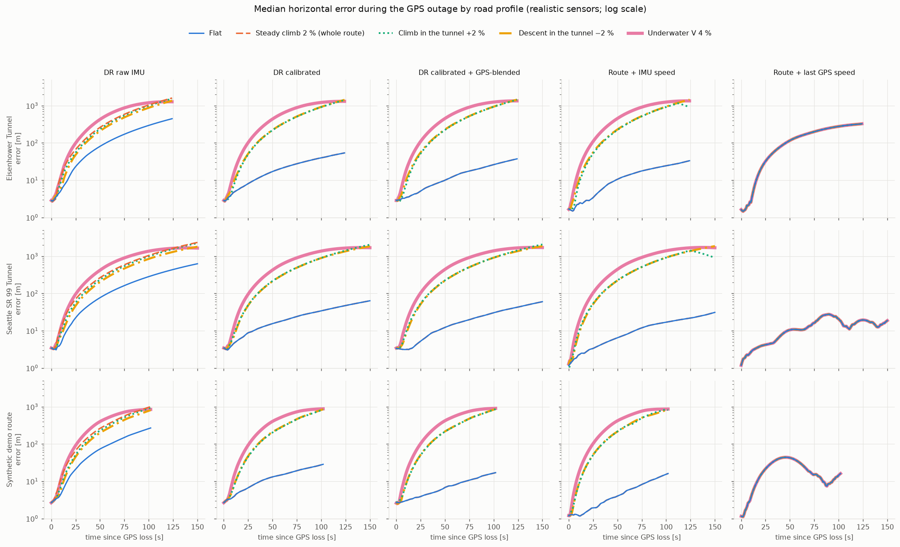
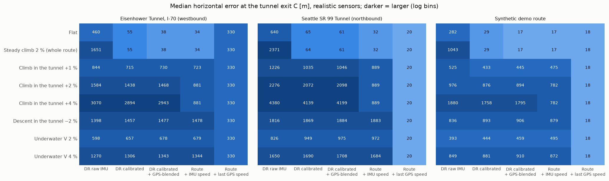

# Road slope: how a grade profile affects the existing estimators

Study of 2026-10-13 (R1, model D36). It measures and explains the effect of road grade; no estimator
was changed. Reproduce with (about 9 min; figures need the dev dependency matplotlib):

```bash
uv run python -m throughtunnel.evaluation.slope_study --seeds 20 --out docs/slope_study
```

Generated outputs in [slope_study/](slope_study/):
* `tables.md`: all tables per preset;
* `runs.csv`: 2,520 rows;
* `curves.csv`;
* the two figures below.

## 1. Design

* **Profiles.** Eight profiles, built from the editor's templates and anchored to B and C:

| profile | shape |
|---|---|
| Flat | reference |
| Steady climb 2 % | the whole route, approach included, climbs at 2 % |
| Climb in the tunnel +1 / +2 / +4 % | level approach, the tunnel climbs, level after C |
| Descent in the tunnel −2 % | level approach, the tunnel descends |
| Underwater V 2 % / 4 % | level approach, descent over 40 % of the tunnel, flat bottom, climb over 40 % |

  Grade changes are spread over 400 m transitions (vertical curves).
* **Same drive.** The horizontal drive is identical for every profile: the profile changes only the
  vertical motion.
* **Two sensor settings:**
  * *ideal*: error-free IMU and GPS, one run. This isolates the slope effect.
  * *realistic*: the preset's IMU noise and bias and GPS errors, 20 runs. Run k uses seed k for every
    profile, so the slope's contribution is a paired difference.
* **Prediction checked.** The levelling during the approach calibrates in the approach grade φ_cal. In
  the tunnel, the forward accelerometer channel then picks up g·(sin φ − sin φ_cal), so the speed error
  at C is g ∫ (sin φ − sin φ_cal) dt. This is compared with the estimator's actual speed error.
* **Two extra checks.** The study also records:
  * the heading error at C, to test whether the slope affects turns;
  * whether `route_imu` reached the route end D before C. That estimator is clamped to the route
    length, which caps its error (marked §).

## 2. Results





**Ideal sensors: `dr_calibrated` at C** (Eisenhower 125 s / Seattle 151 s / synthetic 103 s of dead
reckoning):

| profile | error at C [m] | speed error at C, measured / predicted [m/s] | heading error |
|---|---|---|---|
| Flat | 0 / 0 / 0 | 0 / 0 | ≤ 0.02° |
| Steady climb 2 % | 0 / 0 / 0 | 0 / 0 | ≤ 0.02° |
| Climb +1 % | 729 / 1029 / 437 | E +11.6 / +11.6 | ≤ 0.02° |
| Climb +2 % | 1457 / 2058 / 875 | E +23.3 / +23.2 | ≤ 0.02° |
| Climb +4 % | 2913 / 4115 / 1749 | E +46.5 / +46.3 | ≤ 0.03° |
| Descent −2 % | 1453 / 1861 / 874 | S −20.4 / −28.0 (clamped at 0, see finding 4) | ≤ 0.02° |
| Underwater V 2 % | 651 / 928 / 429 | E +0.4 / +0.5 | ≤ 0.02° |
| Underwater V 4 % | 1301 / 1675 / 857 | E +0.8 / +1.0 | ≤ 0.06° |

**Realistic sensors: median error at C [m]** (20 runs; p90 in `tables.md`):

| profile | dr_raw | dr_calibrated | dr_filtered | route_imu | route_hold |
|---|---|---|---|---|---|
| *Eisenhower* | | | | | |
| Flat | 460 | 55 | 38 | 34 | 330 |
| Steady climb 2 % | 1651 | 55 | 38 | 34 | 330 |
| Climb +1 % | 844 | 715 | 730 | 723 | 330 |
| Climb +2 % | 1584 | 1438 | 1468 | 881 § | 330 |
| Descent −2 % | 1398 | 1457 | 1477 | 1478 | 330 |
| Underwater V 4 % | 1270 | 1306 | 1343 | 1344 | 330 |
| *Seattle* | | | | | |
| Flat | 640 | 65 | 61 | 32 | 20 |
| Steady climb 2 % | 2371 | 64 | 61 | 32 | 20 |
| Climb +1 % | 1226 | 1035 | 1046 | 889 § | 20 |
| Climb +2 % | 2276 | 2072 | 2098 | 889 § | 20 |
| Descent −2 % | 1816 | 1869 | 1884 | 1883 | 20 |
| Underwater V 4 % | 1650 | 1690 | 1708 | 1684 | 20 |
| *Synthetic* | | | | | |
| Flat | 282 | 29 | 17 | 17 | 18 |
| Steady climb 2 % | 1043 | 29 | 17 | 17 | 18 |
| Climb +1 % | 525 | 433 | 445 | 475 | 18 |
| Climb +2 % | 976 | 876 | 894 | 782 § | 18 |
| Descent −2 % | 836 | 893 | 906 | 879 | 18 |
| Underwater V 4 % | 849 | 881 | 910 | 872 | 18 |

§ = in all 20 runs, `route_imu` reached the route end D before the vehicle reached C. Its error is
then the C–D distance, not a measure of accuracy.

**Realistic sensors, Seattle: paired along-track shift at C caused by the profile [m], median [min, max]:**
* Climb +2 %: `dr_calibrated` +1956 [+1925, +1970]; ideal sensors +1935.
* Underwater V 4 %: −1512 [−1570, −1460].

**Realistic sensors: median |heading error| at C (`dr_calibrated`), Seattle:** 1.24° on the flat road
and 1.24–1.26° on every profile.

**Exit announcement (300 m before C), Seattle, `dr_calibrated`, median |error| (signed mean):**
* flat: 1.5 s;
* climb +1 / +2 / +4 %: 27 / 41 / 58 s **early**;
* descent −2 %: 19 s late;
* underwater V 4 %: 19 s late.

## 3. Findings

1. **What matters is the grade *change* after calibration, not the grade.**
   * A steady 2 % climb along the whole route leaves the calibrated estimators exactly as on a flat
     road (55 / 64 / 29 m). The levelling during the approach absorbs it.
   * The same 2 % confined to the tunnel moves them by 0.9–2.1 km.
   * `dr_raw`, which does no levelling, suffers from any grade, the steady climb included
     (+0.8 to +1.7 km).
2. **The physics is gravity leakage, and it is predicted exactly.**
   * Measured and predicted speed errors agree within about 1 %.
   * The error is linear in the grade change (+1 / +2 / +4 % → 729 / 1457 / 2913 m on Eisenhower)
     and changes sign with it (−2 % → −1453 m).
   * Per 1 % of grade change it is 0.4–1.0 km at C, growing as ½·g·Δgrade·τ².
   * A grade change of Δ acts exactly like a pitch calibration error of atan(Δ) (1 % ≈ 0.57°):
     consistent with [calibration_error.md](calibration_error.md).
3. **The slope leaves the heading intact.**
   * Heading error at C is ≤ 0.06° with ideal sensors, and with realistic sensors it is unchanged by
     the profile (1.24° median for `dr_calibrated` on Seattle, flat or sloped).
   * The gyro sees the slope only as a cos(pitch) factor on the turn rate (0.08 % at 4 %). Pitching
     happens about the sideways axis, which the heading does not use.
   * In unconstrained dead reckoning the speed error still produces large *lateral* error on curved
     routes. Example, Seattle +2 % with ideal sensors: +1935 m along-track, +701 m cross-track, with an
     exact heading.
4. **Negative result: on a descent the estimate stops.**
   * Leaked gravity can exceed the vehicle's speed (Seattle −2 %: −28 m/s predicted vs about 20 m/s
     actual).
   * The estimators clamp speed at 0, so the estimate *stands still* in the tunnel. The measured
     error is then smaller than the prediction, but the behaviour is worse: a stopped navigation
     arrow.
5. **Negative result: the underwater V hides its error in the middle.**
   * The speed error builds on the descent and returns to near zero on the climb (+0.4 / +0.8 m/s at
     C).
   * The position error does not return: 0.4–1.7 km at C, and larger in mid-tunnel (figure 1, thick
     line). A check of the speed at the exit would wrongly suggest the estimate is fine.
6. **The route constraint does not help, and on climbs its numbers mislead.**
   * All IMU-integrating estimators shift by the same amount: the error is along-track.
   * On climbs `route_imu` overtakes the vehicle and stops at the route end D in every run, so its
     "error at C" is capped at the C–D distance (782–889 m). That is a property of the scenario
     length, not accuracy.
7. **The exit announcement fails in both directions, asymmetrically.**
   * On climbs the estimate runs ahead and announces the exit 27–58 s **early**, around mid-tunnel.
     There is no limit to how early it can be.
   * On descents and V profiles it lags, and the announcement comes 19–26 s **late**, after the exit
     (saturated by GPS returning).
8. **Only the speed-hold reference is immune.** `route_hold` uses no IMU, so every profile gives the
   flat-road result. With any grade change in the tunnel, it is better than every inertial estimator
   on all three presets (Eisenhower: 330 m vs 0.6–3.1 km).

## 4. What this means

**This is the most important credibility result so far.** The inertial estimators' headline accuracy
(20–60 m at C) requires the tunnel grade to equal the approach grade within roughly **0.03–0.07 %**:
1 % costs 0.4–1.0 km (more in longer tunnels), and the cost is linear in the grade change. Real tunnels have grades:
* a longitudinal grade for drainage;
* climbs in mountain tunnels;
* the V shape of underwater tunnels (4–6 %).

**As implemented, the approach-calibrated IMU speed is not usable in sloped tunnels.**

The heading is unaffected, so the useful parts of the IMU are its *turn* information and short-term
speed changes. The constant-speed assumption (`route_hold`) is immune to grade but fails when traffic
changes speed (R2, not yet simulated).

Directions for improving the estimators. These are not implemented; they are discussion only:
* **Do not integrate a constant forward-acceleration offset over the whole outage.** Treat a slowly
  varying forward bias as unobservable, e.g. accept only transient speed changes (the combined
  estimator discussed after the factor study).
* **Grade information.** The phone's barometer measures height change, i.e. grade, directly
  (tunnel pressure effects caveat). A map with elevation would also work. Either one makes the leakage
  correctable.
* **Along-track corrections from turns** (A7), since the heading survives the slope.

## 5. Limitations

* **Templates, not surveyed profiles.** The presets' real elevation profiles are unknown offline, so
  the magnitudes are illustrative of each *type* of profile.
* **What the driver model ignores.** The driver does not react to the grade (constant speed
  profile). There is no road banking. The vehicle body does not pitch relative to the road.
* **Calibration window.** The calibration uses the whole approach. Profiles that change grade
  *during* the approach were not tested; the levelling then calibrates in an average grade.
* **Sample size.** One drive per preset, 20 sensor seeds. The slope effect is deterministic (the
  paired shifts vary by ±2–3 %), so this is enough.
