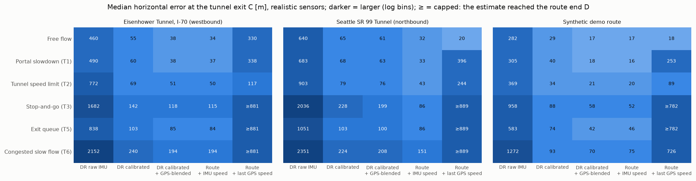
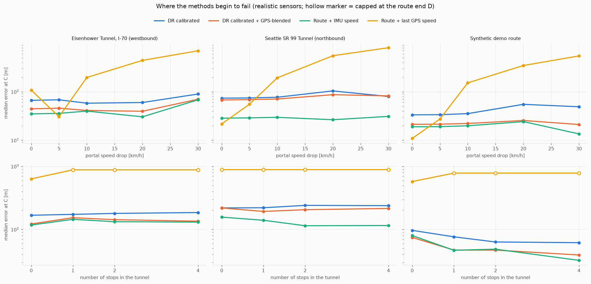

# Traffic in the tunnel: how it affects the existing estimators

Study of 2026-10-13 (R2, model D37; research in [traffic_research.md](traffic_research.md)). It
measures and explains; no estimator was changed. Reproduce with (about 23 min with 2 workers; figures
need the dev dependency matplotlib):

```bash
uv run python -m throughtunnel.evaluation.traffic_study --seeds 20 --out docs/traffic_study
uv run python -m throughtunnel.evaluation.traffic_study --from-csv docs/traffic_study/runs.csv   # tables/figures only
```

Generated outputs in [traffic_study/](traffic_study/):
* `tables.md`: all tables per preset;
* `runs.csv`: 3,240 rows;
* the two figures below.

## 1. What was simulated

* **Traffic model** (D37). Every scenario is built from two shared primitives:
  * *speed zones*: a speed cap between two distances, with gentle braking into the zone and
    acceleration out of it, plus optional smooth variation;
  * *stops*: a real standstill at zero speed for a time-based duration.

  All scenarios are anchored to B and C, with seeded randomness:

| scenario | composition (defaults from the research) |
|---|---|
| Portal slowdown (T1) | −15 km/h from B, braking 0.6 m/s² before B, speeding up again after ~400 m |
| Tunnel speed limit (T2) | 60 km/h through B–C |
| Stop-and-go (T3) | ~30 km/h through B–C with 3 stops of 10–60 s |
| Exit queue (T5) | ~15 km/h over the last ~400 m before C, with one stop |
| Congested slow flow (T6) | ~30 km/h ± 8 km/h through B–C |

  Positions, durations and speeds vary by ±20 % per run.
* **Physical consistency.** The motion stays jerk-limited. Stops end with a constant-jerk
  manoeuvre that brings speed and acceleration to zero together. Truth, IMU and GPS follow from the
  same motion.

  Tests check:
  * a = dv/dt through the stops;
  * the IMU against the numerically differentiated phone pose;
  * gravity-only readings while standing;
  * the planned stop durations.

  Free-flow drives are bit-identical to before.
* **Experiment.** Three presets × six scenarios:
  * *ideal sensors*: one run per scenario;
  * *realistic sensors*: 20 runs per scenario. Run k uses seed k for the sensors, the GPS *and*
    the traffic events.
  * *two sweeps* (10 runs per value): portal speed drop 0–30 km/h, and number of stops 0–4.

**Traffic makes the GPS outage much longer** (Seattle, medians):

| | free | T1 | T2 | T3 | T5 | T6 |
|---|---|---|---|---|---|---|
| time in tunnel [s] | 150 | 156 | 178 | 484 | 273 | 374 |
| standing [s] | 0 | 0 | 0 | 103 | 40 | 0 |
| mean speed in tunnel [km/h] | 71 | 69 | 60 | 22 | 39 | 29 |

## 2. Results





**Realistic sensors, median error at C [m]** (≥ = lower bound: the estimate ran past the route end D
in most runs, so the true error is larger):

| scenario | Eisenhower `route_imu` / `route_hold` | Seattle | Synthetic |
|---|---|---|---|
| Free flow | 34 / 330 | 32 / 20 | 17 / 18 |
| Portal slowdown (T1) | 37 / 338 | 33 / 396 | 16 / 253 |
| Tunnel speed limit (T2) | 50 / 117 | 43 / 244 | 20 / 89 |
| Stop-and-go (T3) | 115 / ≥881 | 86 / ≥889 | 52 / ≥782 |
| Exit queue (T5) | 84 / ≥881 | 86 / ≥889 | 46 / ≥782 |
| Congested (T6) | 194 / ≥881 | 151 / ≥889 | 75 / ≥782 |

**Maximum error in the tunnel, `route_hold` [m]:** 0.7–1.9 km in T3, T5 and T6, i.e. the full error
before the route end caps it.

**Ideal sensors:** every IMU-based estimator stays within **0–7 m** in every scenario, stops included.
`route_hold` is unchanged by perfect sensors (Seattle T1: 374 m).

**Portal-drop sweep (`route_hold`, median at C):**

| drop | 0 km/h | 5 km/h | 10 km/h | 20 km/h | 30 km/h |
|---|---|---|---|---|---|
| Eisenhower / Seattle / Synthetic [m] | 108 / 22 / 11 | 30 / 55 / 27 | 197 / 193 / 152 | 442 / 551 / 346 | 697 / 806 / 546 |

`route_imu` over the same sweep: 14–68 m. The 0 km/h value on Eisenhower (108 m) is the drive's
own slowdown inside the tunnel, which happens to cancel at a 5 km/h drop.

**Heading error at C, `dr_calibrated`, realistic sensors** (median, free → stop-and-go): Eisenhower
0.42° → 1.26°, Seattle 1.24° → 3.81°, synthetic 0.44° → 0.97°.

**Exit announcement, Seattle, median |error| (signed mean; + = late):**

| | free | T1 | T2 | T3 | T5 | T6 |
|---|---|---|---|---|---|---|
| `route_imu` | 1 s | 1 s | 2 s | 9 s (−9) | 9 s (+8) | 16 s (+10) |
| `route_hold` | 1 s | 18 s (+17) | 12 s (−11) | **217 s (−225)** | 27 s (−26) | 117 s (−111) |

## 3. Findings

1. **The constant-speed baseline fails as soon as traffic changes the speed.**
   * **Where it fails:** a systematic drop of about **5 km/h** at the portal already makes it as bad as
     or worse than `route_imu` (27–55 m vs 19–36 m). At 10 km/h it is 150–200 m, at 30 km/h
     0.5–0.8 km.
   * **Stops, queues and congestion** take it 0.7–1.9 km ahead (it runs off the route end).
   * **The exit announcement** comes **3–4 minutes early** in stop-and-go, i.e. far back in the
     tunnel.
   * Perfect sensors do not help: the error is the driver model, not the measurement.
   * Its good free-flow numbers (Seattle 20 m) depend on the driver keeping a constant speed. Traffic
     is exactly when that fails.
2. **The IMU follows traffic speed changes: a real advantage.**
   * With perfect sensors every IMU estimator stays within 0–7 m, even with 100 s of stops and
     5–8 minute outages. Braking, standing and pulling away are measured accelerations.
   * On flat roads, `route_imu` is better than `route_hold` in every traffic scenario. The only
     exceptions are lucky free-flow drives.
3. **With realistic sensors, IMU errors grow with outage *time*, not with traffic events.**
   * Traffic lengthens the outage 2–3.6×. The time-driven drift (calibration and hand-over residuals)
     grows with it: `route_imu` goes from 17–34 m (free) to 52–115 m (stop-and-go) and 75–194 m
     (congested).
   * The stop-count sweep shows that the stops themselves add nothing: more stops mean a longer
     outage, but the IMU estimators' error does not rise. On the synthetic route it even falls, see
     finding 4.
   * The heading drifts with time as well (Seattle 1.2° → 3.8°). The route constraint makes
     `route_imu` immune to that.
4. **Unexpected: the speed clamp acts as a one-sided zero-velocity update.**
   * The estimators clamp their speed at ≥ 0. When the vehicle stops and the estimator's speed error
     is *negative*, the clamp pins the speed at 0, and the error is gone after the stop. Diagnostic
     (Seattle): −0.20 → 0.00 m/s at every stop.
   * When the error is *positive*, the estimate keeps creeping forward while the vehicle stands still,
     and the error survives the stop (+0.3 → +1.1 m/s over the outage).
   * This explains both the falling median and the long tail: the worst quarter of stop-and-go runs is
     **always ahead** (+265 to +512 m, p90 267–530 m), the rest near zero.
   * The asymmetry is an accident of the implementation, not a design. A proper standstill detection
     would remove both signs of error. This is an obvious improvement candidate; not implemented.
5. **At low speed, small position errors become large timing errors.**
   * In the exit queue (≈15 km/h) `route_imu` is 46–86 m off, but the announcement is 5–10 s late:
     1 s is only about 4 m.
   * Announcement timing in congestion is a speed problem as much as a position problem.
6. **Uncalibrated dead reckoning (`dr_raw`) collapses with longer outages.** The error grows
   quadratically with time: median 0.6–2.4 km, p90 up to 9.8 km.

**Where each method begins to fail** (this study):

| method | holds up while | fails when |
|---|---|---|
| `route_hold` (constant speed) | the speed stays within ~5 km/h of the entrance speed | any systematic speed change, slowdowns, stops, queues |
| IMU-based (`dr_calibrated`, `dr_filtered`, `route_imu`) | the outage is short *and* the road is level | the outage grows long (traffic), via time-driven drift; any grade change (slope study) |

## 4. Interaction with road slope (flagged)

Traffic lengthens the outage by 2–3.6×, and gravity leakage from a grade change grows with the
*square* of the outage time (slope study: ½·g·Δgrade·τ²). A congested tunnel with a 1 % grade change
would therefore cost about (450/150)² ≈ 9× the free-flow slope error: several kilometres. This
combination was not simulated. Both failure modes point the same way: an estimator for real tunnels
needs to
* bound along-track drift that grows with time;
* detect standstills;
* get grade information,

while keeping the IMU's ability to follow real speed changes.

## 5. Limitations

* **Single-vehicle traffic model.** Traffic is imposed as speed zones and stops on one vehicle, not
  simulated as interacting vehicles. The wave periods and stop durations are plausible, from the
  research note, but not calibrated to a specific tunnel.
* **Untested variants.** T4 (long incident stop) was skipped by decision. T7 (trucks on climbs) was
  not combined with slopes.
* **Route-end capping.** In the long scenarios `route_hold` overruns the route end. Its errors are
  then reported as lower bounds (≥), and the maximum error in the tunnel is given as well.
* **Sample size.** One road and driver per preset; 20 runs per scenario, 10 per sweep value. The p90
  values are indicative.
